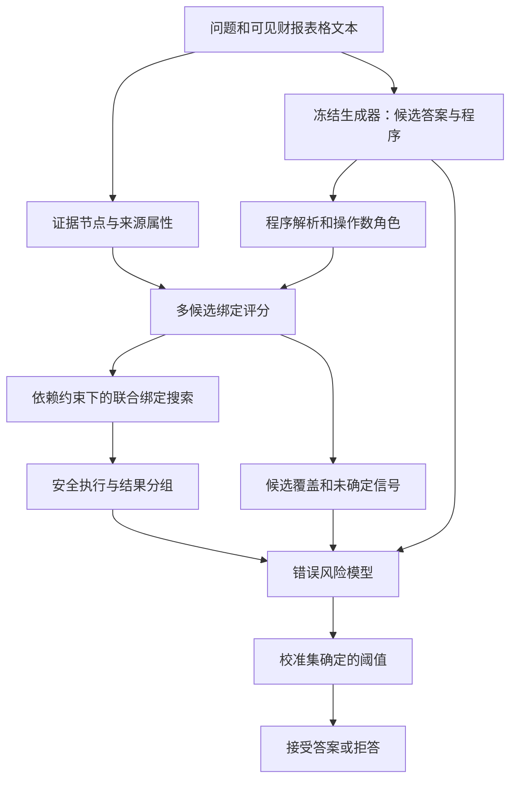

# 面向金融数值问答的证据绑定不确定性感知选择性回答方法研究
## 论文完整研究与撰写方案

版本：2026-10-10，定题方案 v1.0。

**本文是一份可以独立阅读的研究方案，包含调研建议、确定的研究主线和完整论文写作设计。** 原有可行性报告、文献矩阵和实验计划作为核验附件保留。本方案采用已经核验的数据规模和资源信息；算法、创新点和性能目标属于拟开展研究，不写成已经取得的成果。

适用条件：一人完成，没有额外独立人工标注人员；可调用 DeepSeek 等模型辅助训练数据处理；拟使用单张 24GB NVIDIA GPU；用 3–6 个月完成实验、论文和答辩准备。学校发表要求及导师对创新工作量的要求尚未明确。

## 一、调研后的定题结论与总体方案

### 1.1 本轮确定的论文方案题目

**中文题目：面向金融数值问答的证据绑定不确定性感知选择性回答方法研究**

英文工作题目：*Selective Answering for Financial Numerical Question Answering with Evidence-Binding Uncertainty*。

原题“证据—计算一致性建模与选择性回答”范围较宽，容易与现有金融验证系统重叠。本方案将研究对象具体限定为：**表格和文本中的操作数来源存在多种解释时，如何利用证据绑定的不确定性及其对计算结果的影响，决定是否接受一个已有数值答案。**

“证据绑定”是把计算需要的角色，例如“2023 年营业收入”，对应到具体的表格单元格或正文片段；“选择性回答”是系统按风险决定输出答案或拒答，并同时评价回答比例与错误率。

本轮不再并列多个候选题目作为主线。后续实现、实验和写作均围绕上述题目展开；预实验用于检验方法假设并决定是否调整机制，不用来替代当前完整方案。

### 1.2 一页概览

| 项目 | 本方案的确定内容 |
|---|---|
| 研究对象 | 财报表格—文本混合上下文中的金融数值问答 |
| 核心问题 | 取数来源不确定时，执行成功和模型自信不足以判断答案可靠性 |
| 主任务 | 对固定候选数值答案估计错误风险，接受或拒答 |
| 研究内容一 | 利用现有部分证据标签，学习问题条件化的多候选操作数—证据绑定 |
| 研究内容二 | 将绑定依赖、计算结果冲突和搜索未覆盖信息转换为选择风险 |
| 拟议创新一 | 部分证据监督下，保留多来源候选并建模操作数间依赖，避免过早确定唯一来源 |
| 拟议创新二 | 区分来源歧义和结果歧义，利用绑定变化对执行结果的影响进行风险排序 |
| 核心数据 | FinQA；TAT-QA arithmetic；从 TAT-QA 已有标注中留出证据诊断集 |
| 扩展数据 | FinanceReasoning 去同源子集；许可明确后的公开反事实拒答数据 |
| 主要指标 | AURC、固定覆盖率下的错误风险、校准阈值下的实际覆盖和风险 |
| 主计算资源 | 冻结 4B 生成器＋轻量绑定／风险模型；必要时短上下文 QLoRA |
| 人工标注需求 | 不以新增独立人工标注为前提；测试答案对错使用公开 gold |
| 预期交付 | 算法、可复现实验代码、固定数据划分、模型配置、完整硕士论文及答辩材料 |

### 1.3 调研建议及开题判断

建议采用这一收窄后的题目准备开题。它具备明确任务、可获取数据、可运行评测和符合个人资源的实现路径，能够组织成一篇完整硕士论文。需要验证的主要风险是**方法相对强基线是否存在独立增益**，而不是“是否找得到数据”。

不建议把构建图谱、训练金融大模型、证据检索、OCR、答案纠错与拒答全部纳入核心工作。论文聚焦一个主要方法，包含两个相互衔接的研究点及系统性实验；不把常规阈值校准或工具执行包装成额外创新。如果学校要求两个实质独立的新算法，应再与导师核对，这一方案不能自动等同于已经满足该形式要求。

## 二、研究背景、具体问题与研究意义

### 2.1 应用背景

金融报告中的数值问答往往同时涉及正文和表格。回答一个增长率、占比或差额问题，需要确定财务指标、主体、报告期间、数值尺度和计算关系。语言模型可能生成语法正确的程序，却引用了错误年份或错误业务分部的数值。程序执行器能发现除零或运算错误，但无法仅靠运行成功判断所选数字是否符合问题含义。

论文研究的是**给定可见文档条件下的答案可靠性**，不对公司披露本身的真实性作审计结论，也不将答案用于投资决策研究。

### 2.2 一个贯穿论文的说明性例子

以下是人为构造的说明例，不是真实公司数据，也不是已运行实验结果。

| 财务指标，单位：百万元 | 2022 年 | 2023 年 |
|---|---:|---:|
| 集团营业收入 | 100 | 120 |
| A 分部营业收入 | 80 | 100 |

问题：“2023 年集团营业收入同比增长率是多少？”正确取数为 `(120−100)/100=20%`。若误把“A 分部”的两年收入取出，也能成功执行 `(100−80)/80=25%`。

由此产生三个研究层次：

1. **定位层**：同表有多个“收入”，数值 100 也重复出现。按数字匹配或独立最大相似度取数可能绑定错误来源。
2. **关系层**：分子和分母必须属于同一个主体的相邻期间。每个数单独看都合理，组合起来仍可能不符合问题。
3. **决策层**：如果模型对“集团”和“A 分部”的解释接近，执行结果发生冲突，应降低对候选答案的接受程度。如果正文与表格只是重复披露同一个事实，则多来源并不必然意味着应该拒答。

这说明论文要研究的不是简单的“来源越多越不可信”，而是**来源选择是否符合角色、彼此是否兼容，以及分歧是否会改变答案**。

### 2.3 三个科学问题

**RQ1：如何在现有证据标签并不完全指定操作数角色的条件下，学习包含多种合法候选的证据绑定？**

TAT-QA 的 mapping 提供证据位置，但不总是逐一给出“程序第几个操作数对应哪个位置”的唯一答案。FinQA 的证据还更粗。需要部分监督和一对多对齐，而不能假设已有完整精细标注。

**RQ2：如何把多来源绑定及其依赖关系传播到答案风险，而不是仅输出一个引用位置或一个证据相似度？**

需要区分等值重复、冲突来源、单位不兼容和未覆盖证据，避免把所有歧义都视为错误，或把所有计算一致都视为安全。

**RQ3：在固定候选和计算预算下，这种结构信息是否能改善选择性回答，并在更换生成器或数据分布后保持作用？**

如果相同特征的简单分类器、执行规则或答案采样熵已经取得相同效果，就不能认为复杂绑定模型有必要。

### 2.4 研究意义

学术上，本研究将局部的来源不确定性与最终答案的选择风险联系起来，考察语义匹配、操作数依赖和算术执行之间的信息关系。工程上，输出除接受／拒答外，还可包含候选引用、相互冲突的计算结果和主要风险信号，使系统失败更容易定位。实验上，研究公开标签能支持多大程度的证据诊断，并避免将“答案对了”和“来源解释完整正确”混为一谈。

## 三、已阅读文献与文献综述

### 3.1 阅读范围和证据等级

截至 2026-10-10，本轮检索和筛选涉及 35 项研究文献，覆盖金融数值推理、证据验证、选择性回答、不确定性估计与弱监督程序学习。对核心近邻查看了方法、实验或局限相关正文，对主数据和部分近邻下载了代码／数据；其余文献有一部分仅完成摘要和官方记录筛选。

**35 项不等于 35 篇全部逐字通读。** 文末附录按项保留阅读深度和链接，正式写作时按实际阅读状态引用，不把摘要级材料用于未经核实的实现细节。

### 3.2 金融数值问答：从答案生成到可执行推理

FinQA 将财报数值推理组织成带参考程序的任务，TAT-QA 强调表格与文本共同支撑的离散推理。这些资源为答案正确性和部分证据定位提供了可重复评估的基础。[FinQA](https://arxiv.org/abs/2109.00122)、[TAT-QA](https://aclanthology.org/2021.acl-long.254/)。

PoT 将语言推理与数值执行分开，TAT-LLM 探索金融场景的小模型提取与计算；Encore 和 Gold-Guided Programmatic Distillation 则表明可靠过程监督及执行过滤已经形成研究路线。[PoT](https://arxiv.org/abs/2211.12588)、[TAT-LLM](https://arxiv.org/abs/2401.13223)、[Encore](https://aclanthology.org/2024.acl-long.582/)、[Gold-Guided Distillation](https://arxiv.org/html/2607.14709v1)。

因此，本论文直接采用程序表达和安全执行作为基础。拟改进的问题在于：当输入程序可以执行、操作数也确实出现在文档中时，是否仍有取错来源的风险。单纯采用 PoT、LoRA 或教师生成程序，不足以说明本研究的创新。

### 3.3 金融证据核验：已有工作已经进入原题中心

GBFR 通过金融指标图谱组织多步计算与跨路径检查，并在证据不足时拒答；VeriFin 则从事实与公式来源出发验证金融候选声明。二者与原来的“证据—计算一致性＋选择性回答”直接重合。[GBFR，ACL 2026](https://aclanthology.org/2026.acl-long.1273/)、[VeriFin，预印本](https://arxiv.org/html/2608.10213v1)。

FinGround 进一步涉及金融原子声明和细粒度证据定位；FinDeCrowd 所属研究线关注时期、范围等证据约束。[FinGround](https://arxiv.org/html/2604.23588v1)、[FinDeCrowd](https://arxiv.org/html/2609.35782v1)。

这类工作使本论文不能把“加入证据”“多路径一致”“不确定就拒答”分别列为创新。本方案选择研究的是**保留多种来源解释、显式处理来源间依赖，并根据其执行后果估计风险**。该差异是需要实验证明的机制差异，不是换用 TAT-QA 或换用一个小模型后的应用差异。

### 3.4 选择性回答：关键是风险与覆盖的共同评价

Selective QA under Domain Shift 已研究利用校准器识别应拒答的问题。Sufficient Context 区分上下文充分性与模型是否答对；SURE-RAG 将证据支持及不确定性用于回答决策；FRANQ 强调事实正确与上下文忠实的区别。[Selective QA](https://aclanthology.org/2020.acl-main.503/)、[Sufficient Context](https://arxiv.org/abs/2411.06037)、[SURE-RAG](https://arxiv.org/html/2605.03534v1)、[FRANQ](https://aclanthology.org/2026.findings-acl.338/)。

这些研究提示本论文分别报告答案对错、参考证据匹配和接受决策。拒绝所有问题当然可以避免输出错误，但没有问答效用。因此，主结果必须显示在相同回答数量下谁的错误更少，或在相同错误约束下谁能回答更多问题。

### 3.5 不确定性：答案层信号与来源层信号需要直接比较

语义熵通过多次生成的意义差异刻画不确定性，语义熵探针研究降低这类信号的计算成本。Confidently Wrong 在金融问答上研究模型内部状态与错误检测。[Semantic Entropy](https://www.nature.com/articles/s41586-024-07421-0)、[Semantic Entropy Probes](https://arxiv.org/abs/2406.15927)、[Confidently Wrong](https://arxiv.org/html/2607.11414v1)。

本论文不能预设来源不确定性一定优于答案不确定性。必须检验它是否补充了答案概率、自一致性和内部状态未包含的信息；若模型多次稳定地产生同一个错误答案，来源冲突也许提供帮助，但这是待验证的预期，不能写成已有事实。

COIN、Conformal Risk Control 等提供风险校准思路，但适用条件不能省略。本方案以经验风险比较为主，不把常规校准作为原创理论贡献，也不宣称对任意金融报告都能保证低于固定错误率。[COIN](https://arxiv.org/abs/2506.20178)、[Conformal Risk Control](https://proceedings.iclr.cc/paper_files/paper/2024/hash/f3549ef9b5ff520a7e41ff3cc306ab2b-Abstract-Conference.html)。

### 3.6 弱监督与伪正确程序：为什么不能只用执行结果训练

弱监督语义解析早已研究“程序执行结果正确但语义错误”的伪正确程序，以及潜在结构对齐。仅用最终答案监督绑定，会奖励那些碰巧算对的错误来源组合。[Latent Structured Alignments](https://aclanthology.org/D19-1391/)、[MAPO](https://arxiv.org/abs/1807.02322)。

本方案因此优先使用现成 mapping／gold_inds 约束来源，在不确定的角色对齐上保留候选集合；执行匹配只是补充信号。该训练形式也需要与已有弱监督方法联系，不能把“对多个路径求和”单独宣称为新算法。

### 3.7 文献综述形成的研究缺口

本轮调研支持的表述是：**值得进一步研究在部分证据监督条件下，联合来源绑定及执行后果是否能为金融数值答案的选择提供额外有效信息。**

它不支持“现有研究没有处理金融证据或拒答”这样的宽泛说法。更具体的近邻关系如下：

| 对照工作 | 已有能力 | 本文拟验证的差异 | 必须采用的对照 |
|---|---|---|---|
| GBFR | 多路径、图约束及拒答 | 绑定分布和依赖信息是否优于确定性／路径一致信号 | 多候选执行＋一致性规则；完整系统另表比较 |
| VeriFin | 来源约束和符号候选核验 | 非唯一绑定的风险估计是否优于直接接受／拒绝规则 | 同条件的来源规则与执行核验 |
| SURE-RAG | 证据支持分数与不确定性选择 | 显式数值角色及执行后果是否有增益 | 同证据输入的 NLI 聚合＋选择器 |
| Semantic Entropy | 答案意义层的不确定性 | 来源歧义及结果敏感性是否补充答案熵 | 单位／数值规范化的多次生成熵 |
| Confidently Wrong | 金融内部状态错误探针 | 可解释绑定信号是否超过或补充内部特征 | 冻结同一生成器的线性探针 |
| 潜在结构对齐 | 部分监督与伪正确程序控制 | 对齐信息如何用于固定候选的选择风险 | 独立对齐、top-1 和同特征分类器 |

## 四、研究目标、研究内容与拟议创新点

### 4.1 总体目标

构建一个适用于金融数值问答的证据绑定风险模型，在不依赖新增独立人工标注的条件下，使用文档来源、操作数依赖及执行分歧，改善候选答案的错误排序，并在可控拒答比例下减少输出错误答案的概率。

### 4.2 三项研究内容

| 研究内容 | 需要完成的工作 | 中间产物 | 对应问题 |
|---|---|---|---|
| 内容一：部分监督证据绑定 | 证据节点规范化、操作数角色表示、多匹配监督、候选排序 | 角色—来源候选分布、覆盖诊断 | RQ1 |
| 内容二：绑定依赖与执行风险 | 操作数联合兼容性、受限搜索、结果等价类、风险头 | 联合绑定、冲突摘要、错误风险分数 | RQ2 |
| 内容三：选择策略与系统评价 | 阈值校准、强基线、消融、迁移、成本分析 | 风险覆盖曲线、统计结论、复现协议 | RQ3 |

### 4.3 拟议创新点一：面向部分证据标签的联合绑定建模

针对数值重复、角色映射不唯一和多个操作数之间的语义依赖，提出保留多来源候选的绑定模型。模型联合利用行列标题、时期、单位、指标角色与共享来源关系，避免把每个操作数独立匹配到一个最高分位置。训练时使用集合形式的参考支持，而不是将存在歧义的来源强制当作唯一标签。

**需要证明的增量**：在同一候选池和相同标签下，联合建模比 top-1、独立绑定及同特征 MLP 更有用，且不会仅因为证据候选数量增加而得到收益。部分标签训练、候选搜索和图模型均有既有研究，创新应体现在这一针对风险任务的具体建模和可验证效果上。

### 4.4 拟议创新点二：区分来源歧义与结果歧义的风险传播

提出从联合绑定到选择风险的执行感知表示：一方面保留哪些来源彼此兼容，另一方面将不同绑定产生的数值／尺度结果分组，区分重复披露、冲突结果、无效计算和未覆盖候选。模型据此学习候选答案的风险，避免“来源熵高就拒答”或“程序能运行就接受”。

**需要证明的增量**：在相同特征预算和相同生成输出下，这种传播比单纯证据熵、答案熵及来源分数拼接更有效。若只是将几个现成分数输入分类器而没有结构机制收益，则不能作为充分创新。

这两个创新点构成一个连续方法中的两个研究层次，不预先宣称它们等同于两篇独立新算法论文。

### 4.5 实验与工程贡献

建立可复现的金融数值选择性回答协议，明确自然错误、来源诊断和受控扰动的边界；公开数据划分、输入适配、指标和成本记录。这是论文的重要支撑，但不把“整理数据和写实验脚本”单独算成主要算法创新。

### 4.6 问题—创新—证据对应关系

| 问题 | 方法假设 | 证明所需结果 | 不能支持该主张的结果 |
|---|---|---|---|
| 角色来源多义 | 多候选部分监督优于强制唯一映射 | 参考证据 Recall/F1、错误接受风险同步改善 | 仅训练损失下降 |
| 操作数单独合理但组合错误 | 联合依赖优于独立匹配 | 同候选池、同参数预算的依赖消融 | 新方法读取更多 gold 或更长输入 |
| 来源多但答案并不变 | 执行结果分组减少不必要拒答 | 等值重复子集回答率提高而风险不恶化 | 只提高整体准确率、不给覆盖 |
| 答案一致但取数可能错 | 来源信号补充答案层信号 | 答案熵与探针条件下的增量比较 | 只比全接受基线 |
| 方法过重 | 小模型与受限搜索成本合理 | 风险—成本曲线、端到端延迟 | 只报告选择器训练时间 |

## 五、方法设计与技术路线

### 5.1 任务形式化

给定问题 q、可见文档 D、冻结生成器给出的候选答案 a 和程序 p，学习风险函数 `r(q,D,p,a)`。风险越低，越倾向接受该答案。最终输出为答案及证据引用，或拒答及主要风险提示。

训练阶段允许读取所属训练划分的参考答案和证据标注；推理阶段只读取 q、D、p、a。主实验使用同一批预先缓存的候选，所有方法都判断这些候选，不通过重新生成答案改变比较对象。

候选答案正确性采用任务官方规则定义。来源诊断使用参考 mapping／gold_inds，明确这些标签未穷举所有合法证据。模型预测的风险是经验性分数，经校准后估计答案错误倾向，不是对事实绝对真实性的证明。

### 5.2 总体架构



这一流程的可学习部分主要是绑定打分、依赖关系与风险头。执行器和数据转换属于确定性基础设施。各模型顺序运行，避免在 24GB 显存上同时驻留多个大模型。

### 5.3 文档表示与程序表达

表格中的每个数值单元格组成一个来源节点，保留 `table_id、row、column、行标题、列标题、原始数值、规范数值、单位、时期`。正文数值节点保留 `paragraph_id、起止位置、所在句、邻近实体／指标词、单位和时期`。无法可靠提取的属性记为未知，不自动补全为事实。

来源位置必须使用稳定 ID；重复数字仍保留为不同节点，避免数值去重导致主体或年份信息消失。表格与正文确实重复披露时，允许不同位置成为可替代候选。

程序先支持 add、subtract、multiply、divide、比例、均值和数据中必要的有限聚合操作，表示成带中间节点的有向计算图。未知操作、不能解析的表达式、引用缺失或除零均保留失败类型。常量与事实操作数分开记录，但不能根据 `const_*` token 名称一概免除证据要求。

对每个事实操作数形成角色描述，例如“分母：上一年度集团收入”，含目标指标、主体、时期、单位和它在运算中的位置。角色来自推理时可见的问题和候选程序，不能使用测试 gold derivation。绑定打分原则上不读取待验答案 a，避免为了凑出候选答案而选择来源；但程序和角色本身仍可能有误，后续风险头必须保留该局限。

### 5.4 内容一：部分监督的多候选绑定

初始实现为两阶段匹配：先用词项、标题和结构规则获取候选池，再以可训练小模型对“问题＋角色＋证据节点上下文”进行评分。候选池首轮设每角色最多 32 个节点，保留 top-k 的 k=4；这些是调参起点，最终由方法验证集决定。

轻量实现可使用冻结生成器的文本表示池化加小型 MLP；若证据匹配质量不够，再比较小型 cross-encoder。两种实现不可同时无限扩张；第一个月以能明确验证假设的最低成本版本为准。

令角色 i 的来源分数为 `sθ(i,j)`，softmax 产生候选分布 `qθ(j|i)`。对能从已有标注确定一个或多个支持位置的角色，采用集合监督：

\[
\mathcal L_{\mathrm{bind}}=-\sum_{i\in I_{\mathrm{aligned}}}
\log\sum_{j\in A_i}q_\theta(j\mid i).
\]

`A_i` 是由公开证据位置、数值及上下文对齐得到的参考支持集合，不声称等于全部合法来源。若只知道一组证据而不知道哪个位置属于哪个角色，就采用集合覆盖监督或将该角色标为未对齐，不制造唯一标签。报告可对齐比例以及不同策略的影响。

FinQA 的 gold_inds 用于较粗的证据候选监督；不把一整条证据句直接解释为所有操作数的精细位置真值。TAT-QA 的 mapping 作为主细粒度监督。来自 DeepSeek 的角色说明仅用于训练辅助，必须保留与公开原标注的区别。

“未确定／未覆盖”需要单独表示。可以用训练中参考支持位置未进入候选池的情况训练覆盖预测，但此标签只意味着**参考路径未被覆盖**，不能证明文档中不存在其他可答路径。模型的未知状态也不等价于真实不可答标签。

### 5.5 内容二：操作数依赖与联合绑定搜索

每个联合绑定 z 为多个角色各选择一个来源。总评分采用局部分数与关系分数：

\[
F_\theta(z)=\sum_i s_\theta(i,z_i)
+\lambda\sum_{(i,l)\in\mathcal E_p}\psi_\theta(i,l,z_i,z_l).
\]

关系边优先连接同一个运算中的操作数和复用的程序变量，不对所有节点建立高成本全连接。关系特征包括主体是否一致、时期是否满足问题中的比较关系、单位是否可转换、是否来自同一表头范围，以及程序中同一变量是否被绑定到互相矛盾的来源。

约束必须由问题和运算决定。例如增长率需要不同年份，不能设成“所有操作数年份相同”；跨分部求和也不能要求主体完全相同。仅明确不合法的类型／算术情况作为硬约束，语义不确定的情况采用软得分或未知状态。

初始采用 beam width=16、每角色 k=4，逐角色扩展并保留高分组合。评估 k=1/2/4/8 和 beam=1/4/16 的成本收益。若一题有 m 个角色，简单实现的候选扩展约为 `O(m×beam×k)`，另加关系评分与执行成本；这不包含候选编码，也不宣称精确遍历全部组合。

依赖参数可在 G 阶段用已有参考支持构成的兼容集合学习；无法确定完整联合 gold 的样本使用部分监督并记录覆盖。第一个版本可先固定可解释关系权重，确认有效后再学习关系参数，并比较固定／学习版本，避免在没有标签支撑时强行训练复杂图网络。

### 5.6 执行结果分组与不确定性表示

对每个保留的 z 运行受限执行器，得到数值、尺度和有效性标记。程序允许范围之外的 Python 不直接执行。结果先按任务的确定性规范化规则生成分组键；例如 FinQA 使用官方精度规则。不能直接把任意“相对误差小于某阈值”视为等价关系，因为这种近似关系未必具有传递性。

在 beam 内归一化联合评分，得到各结果组的相对支持。计算以下特征：

| 特征 | 含义 | 希望解决的问题 |
|---|---|---|
| 角色来源熵、top-1/top-2 间隔 | 单个角色的来源集中程度 | 找出不确定的取数位置 |
| 关系兼容程度 | 多个来源是否满足问题关系 | 识别独立合理、组合错误 |
| 候选答案支持分数 | 支持 a 的有效绑定所占相对权重 | 对固定答案建立证据支持信号 |
| 执行结果组熵／最大组支持 | 不同来源是否给出不同结果 | 区分来源多样与结果冲突 |
| 无效计算比例 | 候选组合中的类型／算术失败 | 暴露错误程序或不兼容绑定 |
| 候选池覆盖、截断、未确定属性 | 证据搜索及属性提取是否完整 | 防止只在残余候选上过度自信 |
| 程序／答案一致标记、生成器置信度 | 候选生成质量 | 补充绑定模型看不到的公式与文本输出错误 |

beam 内的归一化支持不是全空间真实概率。未搜索到的绑定可能改变结果，因此保留候选池大小、top-k 截断分数、参考覆盖预测等特征，进行 beam 敏感性实验，不声称已精确计算未知概率质量。

对于“不确定来源但结果相同”的情况，仍保留角色与关系兼容性，不能仅凭相同结果就认定来源忠实。对于“错误公式下所有绑定都一致”的情况，执行熵可能很低，必须通过基线和错误分析暴露这种失败边界。

### 5.7 风险头、训练与回答决策

绑定器及依赖模块在 G 上训练、在 V 上选结构与参数；冻结后在 S 上生成上述特征。以官方评测得到错误标签 `e=1`，训练风险头：

\[
\mathcal L_{\mathrm{risk}}=-\sum_n[e_n\log r_\phi(x_n)
+(1-e_n)\log(1-r_\phi(x_n))].
\]

首选 Logistic Regression 或两层小 MLP，二者与结构模型共同形成公平对照。不要对所有模块进行复杂端到端训练后再讨论来源信号；分阶段训练更容易分清每部分的贡献。S 不用于生成器微调，减少“在生成器记住的题目上学习错误率”的偏差。

在官方 dev 的 C 集上确定阈值 t。推理时 `r≤t` 接受，否则拒答；解析或执行完全失败的候选按预定规则处理，并计入总体失败和覆盖，不能删除。风险校准方式对各方法一致。

### 5.8 推理伪代码

```text
输入：问题 q、可见文档 D、缓存候选答案 a、程序 p
1. 解析 p，提取推理时可见的操作数角色；记录失败状态。
2. 将 D 转为带坐标和上下文的来源节点；标明未知属性。
3. 对各角色获取候选池，计算匹配分数并保留 top-k。
4. 根据问题与程序关系，使用受限 beam 搜索联合绑定。
5. 安全执行保留绑定，按数值和尺度规范分组。
6. 汇总来源分歧、关系兼容、执行冲突和未覆盖特征。
7. 风险头估计 r；按已冻结阈值接受或拒答。
输出：决策、候选答案、引用候选、主要风险信号。
```

### 5.9 实现顺序与软件模块

| 模块 | 必须具备的功能 | 完成后如何检查 |
|---|---|---|
| data_adapter | 原始数据转换、稳定坐标、训练／推理字段分离 | 不读取测试 gold 的输入快照；坐标可回查 |
| candidate_generator | 固定模型、模板和版本；缓存答案与程序 | 同一道题所有验证器使用完全相同的候选 hash |
| evidence_binder | 候选池、集合监督、角色匹配 | 参考 Recall@k、对齐覆盖与困难案例 |
| joint_executor | 依赖评分、beam、受限执行及结果分组 | 负号、尺度、除零、重复变量和歧义组合用例 |
| risk_selector | 风险特征、训练、校准与决策 | S/V/C/T 严格分离；不利用测试标签选择阈值 |
| evaluation | 官方答案评分、风险覆盖、分组区间及成本 | 指标边界用例、接受数和错误数可逐条追溯 |

以上是待实现的算法模块设计；本轮已存在的代码是数据审计与划分脚本，不能把这张模块表写成代码已经全部完成。

## 六、数据、标签与无新增人工标注方案

### 6.1 主数据与已核验字段

| 数据 | 训练／验证／测试规模 | 本文使用的标签 | 用途 |
|---|---:|---|---|
| FinQA | 6,251／883／1,147 | exe_ans、program、gold_inds | 全部程序题主实验、粗证据诊断 |
| TAT-QA 全任务 | 13,215／1,668／1,663 | answer、answer_type、scale、derivation | 数据转换及任务背景；不将非数值题混入主表 |
| TAT-QA arithmetic | 5,543／718／699 | 数值答案、尺度、推导 | 主计算实验 |
| TAT-QA TAGOP train | 13,215 条都有 mapping，其中 arithmetic 5,543 | 表格／文本位置、facts | 绑定训练及留出来源定位测试 |

当前下载版本 TAT-QA 总数为 16,546。TAGOP dev 不含完整答案和 mapping；raw test 没有 mapping，不能声称官方测试集有全量细粒度来源金标。可以从训练集留出已有 mapping 的 B 集解决证据诊断需求。

本地已运行的自检是：FinQA 8,281 条 gold 程序回算全部匹配，TAT-QA 全部 gold 自评分 EM/F1/scale 为 1.0。它们证明数据和指标适配可用，不代表生成器性能，也不保证每条语义标注都没有争议。

### 6.2 已确定的分阶段划分

使用已生成的 `topic-a-20261010-v1` 清单。FinQA 训练数据按公司／年份报告组切分，TAT-QA 按 table uid 切分；比例按组而非逐题划分，因此题目比例不必恰好等于组比例。

| 划分 | FinQA 题数／报告组 | TAT-QA arithmetic 题数／表格组总数 | 使用规则 |
|---|---:|---:|---|
| G：生成或绑定训练 | 3,532／444 | 3,306／1,320 | 可用训练参考标签；必要时微调生成器 |
| S：风险头训练 | 1,303／148 | 1,116／440 | 冻结前级后生成错误标签 |
| V：方法调参 | 708／74 | 565／220 | 选 k、beam、损失及容量 |
| B：证据诊断测试 | 708／75 | 556／221 | 方法冻结后评估参考证据定位 |
| C：官方 dev 校准 | 883 | 718／278 | 最终阈值校准 |
| T：官方 test | 1,147 | 699／277 | 最终答案与选择风险 |

表格组总数来自对应全任务划分，不意味着每张表都一定有 arithmetic 题。主训练与测试需按题型过滤，保留完整 group 身份。

### 6.3 同源数据和泄漏控制

FinQA 官方 train/test 没有重复页面，但共享 243 个公司—年份报告组。主协议保留官方测试以便比较，同时明确其不是跨报告独立实验。TAT-QA 只核验了表格 uid 互斥，不能据此声称公司或年报级独立。

扩展的 report-disjoint 实验从原 train+dev 按报告组重新划分全部阶段，使用独立训练的模型和独立命名的结果表。官方 test 结果与自定义分割结果不能混写。程序参考、gold evidence、预选 model_input 和测试答案均不进入推理输入；参考证据输入只允许出现在单独标记的 oracle 上限实验。

### 6.4 扩展 benchmark 的明确用法

| 资源 | 核验情况 | 本文安排 |
|---|---|---|
| FinanceReasoning | 2,238 条；795 条 source 属 CodeFinQA-test，288 条属 CodeTAT-QA-test | 分离同源题；其余 1,155 条再查文档／函数模板重叠后做迁移 |
| FinanceBench | 150 条公开题及部分旧模型人工结果标签 | 小规模外部诊断；不同时承担训练、校准和测试 |
| GBFR 反事实 | FinQA 97、TAT-QA 151（计算题 73）、FinanceReasoning 412、CFBenchmark 11 | 许可范围明确后复用已有标签；母题与衍生题同组，单独报告不可答诊断 |
| VeriFin／XBRL | 部分资源可读，派生数据许可 pending | 近邻分析；不作主数据前置条件 |
| DocMath-Eval | 官网已宣布测试答案释放；下载需登录接受条款，本轮未获取 | 六个月版可选，不影响核心开题 |
| CFQA | 500 条中文混合问答的论文资源线索 | 可选中文验证，不作为训练主线 |

资源链接分别为 [FinanceReasoning](https://github.com/BUPT-Reasoning-Lab/FinanceReasoning)、[FinanceBench](https://github.com/patronus-ai/financebench)、[GBFR](https://github.com/aolaoban/Graph-Bounded_Financial_Reasoning)、[VeriFin](https://github.com/verifiedfinance/anon)、[DocMath](https://huggingface.co/datasets/yale-nlp/DocMath-Eval)、[CFQA](https://aclanthology.org/2026.fnp-1.3/)。

### 6.5 DeepSeek 辅助标注流程

主测试正确性直接来自公开 gold；DeepSeek 用于 G 内的角色解释、候选对齐和受限程序辅助，流程如下：

1. 从 G 取 300 条样本验证提示与过滤，再扩展至 600–2,000 条难例。
2. 要求教师返回带 source_id 的结构化结果；如提示包含 gold，明确记录该事实。
3. 校验位置存在、数值可解析、尺度明确、程序在白名单内，并比较执行与训练答案。
4. 多个来源均可能成立时保留集合，无法确定时保留未对齐，不制造确定标签。
5. 缓存原始回应、模型标识、提示 hash、token 数和过滤原因。
6. 比较“公开标签”“公开标签＋未经筛选弱标签”“公开标签＋筛选弱标签”，分析过滤是否有效。

教师与第二个模型判断一致，不等于独立人工金标。作者可检查典型错误案例并解释其合理性，但无第二位标注者时不报告双人一致性或宣称自建语义测试集已独立验证。

## 七、实验设计与评价方案

### 7.1 生成器和实验条件

主生成器采用固定 revision 的 [Qwen3-4B](https://huggingface.co/Qwen/Qwen3-4B)，先冻结使用；统一非 thinking 模式、模板和输入范围。必要时只在 G 上做 QLoRA。主候选生成一次后缓存，验证器比较不改变候选。

迁移生成器可用 [Qwen2.5-7B-Instruct](https://huggingface.co/Qwen/Qwen2.5-7B-Instruct)，用于模型代际迁移；二者仍是同系列，不夸称跨家族泛化。DeepSeek 可作为后续 API 生成器扩展，单列无法读取内部状态的设置。

多次采样只用于答案一致性基线和不确定性特征，采用预先固定的随机种子与采样参数；其第一个样本或另行固定的主候选不随验证方法改变。所有额外采样计入成本。

### 7.2 必做基线

| 编号 | 方法 | 为什么必须比较 |
|---|---|---|
| B0 | 全接受、随机排序 | 确定原始错误率与无信息参照 |
| B1 | 平均／最小 token logprob、自报置信度 | 排除仅靠模型自身信心已足够的情况 |
| B2 | k=4 的自一致性、规范化答案熵；k=8 敏感性 | 与答案层不确定性直接比较 |
| B3 | 执行成功、来源存在、时期／单位规则 | 检验新模型是否只是替代简单规则 |
| B4 | 同特征 Logistic Regression／MLP | 控制输入信息、标签和模型容量 |
| B5 | NLI 证据支持聚合＋选择器 | 检验显式数值结构是否超过一般证据支持 |
| B6 | 冻结生成器的内部状态线性探针 | 对照金融问答近邻错误检测方法 |
| B7 | top-1 绑定、独立绑定、多绑定直接一致性 | 检验联合依赖和执行分组机制 |
| M | 本文联合绑定＋执行感知风险 | 在相同候选、输入及校准协议下比较 |

三个月版本优先完成 B0–B4、B7、M，并至少完成 B5/B6 中一个；正式声称优于金融内部状态检测时必须完成 B6。无法复现的近邻须说明限制，不能用缺失结果支持“优于全部现有方法”。GBFR 属完整系统，另做同预算系统级对比，不混进固定候选表冒充相同任务。

### 7.3 主指标

设 e_i=1 表示答案错误，A_i(t)=1 表示阈值 t 下接受：

\[
\mathrm{Coverage}(t)=\frac{\sum_i A_i(t)}{N},\quad
\mathrm{Risk}(t)=\frac{\sum_i A_i(t)e_i}{\sum_i A_i(t)}.
\]

零接受时 Risk 记为 N/A。AURC 按风险排序后对所有接受前缀的错误率取平均；同分排序规则固定，不使用正确标签打破平局，并补充按同分组展示的曲线。

| 指标组 | 具体指标 | 解释 |
|---|---|---|
| 主性能 | AURC；Risk@50/70/90% coverage | 同等回答量下比较错误，越低越好 |
| 部署工作点 | C 校准后，在 T 的实际 coverage、risk、接受数和错误数 | 不根据 T 标签选择最有利阈值 |
| 原始任务 | FinQA execution accuracy；TAT-QA EM/F1/scale | 记录固定生成器底座能力及输出适配 |
| 排序与校准 | AUROC、AUPRC-error、Brier、ECE | 错误为正类；ECE 分箱预先固定 |
| 来源机制 | B 集 Recall@k、参考 mapping F1、对齐率 | 仅参考证据诊断，不代表所有合法链的完整判定 |
| 效率 | 每题额外 token、端到端延迟、峰值显存、GPU 小时 | 成本包含生成、验证和额外采样 |

官方指标各自保留；如另设统一严格数值指标，应明确符号、比例、单位和舍入规则。VeriFin 的 decision coverage 包含对候选的接受和拒绝，不能与此处回答覆盖率直接混比。

### 7.4 核心实验矩阵

| 实验 | 输入与比较 | 要回答的问题 | 输出图表 |
|---|---|---|---|
| E1 主结果 | FinQA、TAT-QA arithmetic，同一主生成器的固定候选 | 方法能否降低选择风险 | 两张风险覆盖曲线；AURC、固定覆盖风险表 |
| E2 绑定消融 | top-1／独立／联合；相同候选池与训练标签 | 创新一是否成立 | 绑定 Recall/F1 与选择风险并列表 |
| E3 传播消融 | 无执行分组／仅答案熵／加入执行冲突；同风险头 | 创新二是否成立 | AURC 消融表及两类歧义子集分析 |
| E4 信息控制 | 同特征 LR/MLP、同容量、同调用预算 | 是否只是多标签或更多算力 | 等信息比较表 |
| E5 覆盖敏感性 | k、beam、输入长度和候选召回变化 | 搜索遗漏是否造成假自信 | 风险—候选召回、风险—时间曲线 |
| E6 监督质量 | 仅 gold／原始弱标签／过滤弱标签 | LLM 辅助是否必要且有效 | 标签通过率、绑定与风险指标 |
| E7 迁移 | 固定验证器换生成器；重用／重校准阈值分开 | 收益是否过拟合某生成器 | 各迁移条件风险覆盖表 |
| E8 诊断 | 原自然题、受控扰动、可用公开反事实集 | 哪些错误被发现，哪些仍失败 | 类型计数、误接受率、案例 |
| E9 扩展 | 严格跨报告、去同源 FinanceReasoning、完整近邻 | 六个月版的外部有效性 | 独立标记的扩展结果表 |

主表记录完整分母：解析失败、截断、未支持操作均计入总体，不先删难题再报告性能。可另报有效程序子集，但须同时给出其占比。

### 7.5 受控扰动与不可答诊断

先按原始 group 分割，再在各划分内部构造扰动。训练扰动不使用 test 母题。数值变换只有在已知参考链涉及的位置与答案能够一致更新时才产生自动 gold；此类题是受控算术测试，不能冒充真实公司数据。

年份、主体替换或删除一条证据，不必然让整个文档不可回答。无独立人工核验时，最多标注“参考链失效”或“指定证据子集不可执行”，不直接赋予全局不可答 gold。公开已有反事实标签可作补充，明确其来源和许可，分别报告自然集和反事实集。

### 7.6 统计与实验冻结

预实验采用 1 个种子筛选；正式主要训练配置采用 3 个种子，报告均值和标准差。方法间差异按报告／表格组做配对 bootstrap，建议 2,000 次，并给出 95% 区间。母题和变体必须同组。

主要终点预先定为“Qwen3-4B 候选上的 FinQA AURC 与 TAT-QA arithmetic AURC”，两个数据集分别报告；不通过临时增加大量子集挑选最有利结果。其余实验支持机制解释。若同时检验多个正式假设，预先规定多重比较处理；探索性结果单独标明。

先在 V 确定方法和超参数，再在 C 校准，最终只对 T 进行冻结评价。报告分组区间不等于获得严格分布无关风险保证；特别是 FinQA 官方报告重叠及域偏移仍需作为局限。

## 八、资源配置、工作量与费用预算

### 8.1 人力及计算配置

| 资源 | 配置与安排 | 当前状态 |
|---|---|---|
| 研究人员 | 一人负责代码、实验和写作；无新增独立标注者 | 已知约束 |
| 本地电脑 | 用于数据转换、CPU 审计、文献与写作 | 已用于数据和官方指标自检 |
| 主 GPU | 单张 24GB NVIDIA；模型顺序加载 | 拟使用，型号和每周可用时长待落实 |
| 主机内存 | 建议 32GB 起，缓存较大时增加 | 资源规划 |
| 存储 | 建议 50–100GB，覆盖模型、缓存输出和检查点 | 资源规划 |
| 模型 | 4B 冻结生成器为主；7B 量化推理作扩展 | 权重与实际吞吐本轮尚未测试 |
| 训练方式 | 小模型头优先；必要时 4B QLoRA | 无需全参数训练 |
| API | DeepSeek 等辅助 G 内难例处理 | 本轮没有调用付费服务 |

本地 24GB 统一内存不能等同于已经具备 24GB CUDA 显存。是否匹配论文进度，需要同时核验显存和可使用时数。

### 8.2 初始训练配置与逐级升级

第一版冻结生成器，离线缓存输出与表示，训练绑定打分器和风险头。若需要 QLoRA，起步配置为输入长度 2,048、micro-batch=1、梯度累积 16 或 32、LoRA rank 8 或 16、梯度检查点；通过显存测试后再考虑 4,096 长度。该配置是试验起点，不是已确认能在任意 24GB 卡运行的承诺。

4B 的 4-bit 权重理论约 2GB，BF16 约 8GB，仅为权重本体；实际内存还包括未量化层、元数据、激活、KV cache、优化器及框架开销。[QLoRA](https://arxiv.org/abs/2305.14314) 是现有高效训练方案，在本文中属于实现工具。

升级顺序为：先修复输入与解析 → 再提高证据候选召回 → 再调整绑定模型 → 最后考虑生成器适配。不能一开始更换更大生成器掩盖绑定算法是否有效。

### 8.3 GPU 时间和 API 费用模型

按 10,000 道有效题、每题 4 次生成、单次 2,000 输入 token 和 256 输出 token 估算，需处理 8,000 万输入和 1,024 万输出 token。在 prefill 500–2,000 token/s、decode 20–60 token/s 的假设下，串行纯生成约 59–187 小时，验证、训练与失败重试另外计算。吞吐范围仅用于规划，不是实测跑分。

三个月方案预留约 150–400 GPU 小时，六个月扩展约 300–800 小时，第一周实测后修订。若每周仅能使用 5 小时，12 周只有 60 小时，明显不够原规划，应减少采样、控制扩展或分担至 API。

教师标注 2,000 条、平均输入 3,000 和输出 800 token，加 20% 重试，约 720 万输入、192 万输出 token。费用按实际服务报价计算：

`总费用 = 7.2 × 每百万输入价格 + 1.92 × 每百万输出价格`。

租卡费用按 `实际 GPU 小时 × 实际小时单价` 计算。当前没有确定预算与单价，不填未经核实的金额，也不默认必须租卡。文献访问、已有公开数据下载和本地 CPU 审计不需要模型调用费用。

### 8.4 首周需要取得的实测资源证据

运行 100 道代表性题目，记录输入长度、输出长度、解析率、token/s、单题总时延和峰值显存；若微调不可避免，再跑 100 个训练 step。将长上下文题和短题分别统计，不能只用极短样例判断全数据可跑。

## 九、预期效果、验收标准与结果呈现

### 9.1 预期解决到什么程度

预期贡献是**在保留一定回答覆盖的条件下，减少被接受答案中的错误，并解释来源分歧与结果冲突的作用**。不承诺消除全部幻觉，不承诺达到公开排行榜最高准确率，也不保证所有错误都能通过证据绑定识别。

主任务固定候选答案，因此当覆盖率为 100% 时，各验证器对应的原始答案准确率相同。方法收益应体现在风险排序和接受集合，而不是声称仅靠拒答模块提高了全覆盖生成准确率。若另做重生成纠错，应单独设实验，不把其效果算作本方案的主贡献。

### 9.2 预期方向、量化目标与成立依据

下表数字是**建议预先登记的研究目标，不是实验预测、现有成绩或硕士毕业标准**。正式值可在仅使用 G/V 的预实验后修订一次，随后冻结，不能看 T 结果后追改目标。

| 维度 | 预期方向 | 建议目标／最低证据 |
|---|---|---|
| 候选召回 | 支持主要参考取数位置进入候选池 | V 上参考证据 Recall@k 争取达到约 90%；达不到先查候选池，不急于堆模型 |
| 主选择性能 | 相比最强可比基线降低 AURC | 争取两个主数据集均改善，至少一个达到约 5%–10% 相对下降；给出绝对差与区间 |
| 固定覆盖风险 | 相同回答量时错误更少 | 70% 覆盖时争取约 2 个百分点绝对风险下降；若基线已接近零则报告实际空间，不能强求此数字 |
| 结构机制 | 联合依赖优于独立匹配 | 消融改善可重复，配对区间支持预设方向；不以单个种子或一个案例替代 |
| 执行传播 | 减少等值重复导致的过度拒答，识别冲突结果 | 两类诊断分开报告；不能靠删除困难题得出改善 |
| 迁移 | 换生成器后仍有方向一致的收益 | 至少一个冻结验证器的迁移实验；重校准与零重校准分开 |
| 资源 | 单张 24GB 可完成最小方案 | 实测峰值显存、完整运行日志和时间预算，不只给理论参数量 |

两个数据集的主终点分别检验。699 道 TAT-QA 测试计算题上的小幅差异可能有较宽区间；若区间不足以支持优势，要报告不确定性，不能因为“达到目标百分比”就宣称方法有效。

### 9.3 哪些结果足以支持论文结论

最有说服力的证据组合是：主结果优于强基线；两项机制消融符合预期；同特征与同预算对照仍有增益；来源诊断能够解释变化；至少一次迁移不完全失效。这比只报告一个较高答案准确率更适合本题。

如果总体 AURC 有改善但联合模型没有超过简单分类器，论文只能说明特征有效，不能继续声称结构方法有效。如果仅人工扰动集有收益、自然数据没有，应把结论限制为受控诊断。负结果不是可以隐藏的异常点，而是决定题目需要调整的依据。

### 9.4 最终应交付的成果

1. 一篇围绕明确研究问题的完整硕士论文，包含文献综述、方法、主实验、消融、迁移、成本与局限。
2. 一套可复现代码：数据适配、冻结候选生成、绑定模型、执行器、风险校准和评测。
3. 固定数据划分与样本 hash、模型与提示版本、运行配置、随机种子和日志。
4. 核心结果表、风险覆盖曲线、消融表、成本曲线以及可追溯的错误案例。
5. 开题材料、中期材料和答辩演示所需的图表与概述。

论文发表属于可能的后续成果，当前不承诺会议档次或录用。如果学校有强制发表要求，应另行倒排投稿与审稿周期。

## 十、完整论文结构与逐章写作方案

以下以七章组织论文。章节数量可适配学校模板，但问题、方法与证据链保持完整。每章都说明“写什么、依靠什么材料、读者最终应理解什么”。

### 第 1 章 绪论

**1.1 研究背景与意义**：介绍财报数值问答场景，以及时期、单位、主体和公式选择共同影响结果的原因。用本方案第 2.2 节的说明例引入取数错误，不泛泛铺陈大模型发展史。

**1.2 研究问题与挑战**：定义来源不唯一、操作数依赖和风险传播三个挑战，区分答案对错与来源支持。

**1.3 研究内容与主要贡献**：围绕两项拟议方法点组织；正式论文最终版本只能写实验确实支持的贡献。训练方式、执行器和标准校准不单列成创新。

**1.4 论文组织结构**：说明后续章节与 RQ1–RQ3 的对应。

需要的材料：说明案例、近邻差异表、最终贡献摘要。完成标准：读者能用一段话说明论文具体解决什么问题。

### 第 2 章 相关研究与技术基础

**2.1 金融数值问答与程序推理**：FinQA、TAT-QA、PoT、TAT-LLM、Encore 和可靠程序蒸馏。

**2.2 证据归因与金融声明核验**：GBFR、VeriFin、FinGround 等，讨论输入、来源约束与接受决策。

**2.3 不确定性估计与选择性回答**：语义熵、内部状态探针、上下文充分性及校准。

**2.4 弱监督语义解析与伪正确程序**：说明为什么答案监督不等于来源监督，以及集合对齐的由来。

**2.5 本章小结与研究定位**：归纳已有能力、尚待验证的问题和本论文的具体差异。

写法：按研究问题组织综述，每一节比较任务、方法、监督和评价，不写成逐篇摘要堆叠。正文重点引用直接近邻，附录保留扩展资源。完成标准：能够回答“为什么不是将几篇已有方法简单拼起来”。

### 第 3 章 任务定义、数据资源与评价协议

**3.1 问题、文档、候选程序与接受决策的定义**。

**3.2 数据来源、字段与证据监督粒度**：展示已经核验的规模和 mapping 可用范围。

**3.3 G/S/V/B/C/T 划分与同源控制**：解释为何单独留出风险头训练和证据诊断。

**3.4 数值规范化、官方指标和风险覆盖指标**。

**3.5 统计协议与实验公平性**：候选固定、预算一致、组抽样、标签隔离。

需要的表：数据规模表、标签可用性表、分割表、评分定义表。完成标准：其他研究者能依据此章重建实验分母与评价过程。

### 第 4 章 部分监督的联合证据绑定方法

**4.1 方法动机与总体结构**：从重复数值和角色多义引出方法。

**4.2 证据节点和操作数角色表示**：明确坐标、属性、未知值与常量处理。

**4.3 多候选匹配与集合监督**：写出损失、对齐失败处理及弱标签边界。

**4.4 操作数关系与联合绑定搜索**：给出关系函数、软／硬约束和 beam 算法。

**4.5 复杂度与实现配置**：分别分析编码、搜索、执行，不只分析最轻部分。

**4.6 本章小结**：总结该模块输出什么，为后续风险建模提供什么信息。

需要的图表：来源节点示意图、联合／独立绑定对比、算法伪代码、训练标签例子。关键实验集中在第 6 章，避免两章重复结果表。

### 第 5 章 执行感知风险建模与选择性回答

**5.1 来源不确定性与结果不确定性的区别**：并列重复披露和冲突结果案例。

**5.2 安全执行与结果规范化分组**：说明尺度、负号、无效操作和等价类定义。

**5.3 未覆盖信息与风险特征**：说明 beam 截断为什么会导致过度自信，以及如何显式保留该信息。

**5.4 风险训练及阈值校准**：给出训练目标与冻结顺序，解释为什么不能用测试标签调阈值。

**5.5 输出形式与失败边界**：错误公式、自信绑定错误、未穷举合法链等边界。

需要的图表：风险模型流程、来源熵与结果熵示意、推理伪代码、校准流程。完成标准：读者知道方法为何可能有效，也知道其不能保证什么。

### 第 6 章 实验结果与分析

**6.1 实验设置**：模型版本、数据规模、基线、硬件与参数。

**6.2 主实验**：两个主数据分别报告 AURC、固定覆盖风险和部署工作点。

**6.3 绑定机制消融**：回答 RQ1；比较 top-1、独立与联合绑定。

**6.4 风险传播消融及等信息对照**：回答 RQ2；说明是否只是新增特征。

**6.5 迁移、稳健性与成本**：回答 RQ3；区分重校准与直接迁移。

**6.6 误差分析与局限**：至少包括取数、时期、单位、公式、执行、截断和答案适配错误，给出成功与失败案例。

每一节按“问题 → 设置 → 实际观察 → 统计证据 → 解释与边界”写，避免把预期原因当作已证实因果。结果不好时如实缩减结论，不通过更换指标或删题掩盖。

### 第 7 章 总结与展望

分别回答 RQ1–RQ3，并只总结实验支持的结论。局限包括部分证据金标、公开基准同源、生成器可能接触过训练语料、搜索近似和实际业务外推范围。未来工作可涉及更复杂公式、中文财报、长文档和预算自适应，但这些不倒写成已完成贡献。

### 10.1 全文预计需要的主要图表

| 编号 | 图表 | 作用 |
|---|---|---|
| 图 1 | 来源取错但程序可执行的案例 | 引出研究问题 |
| 图 2 | 总体方法架构 | 展示信息流和训练／推理边界 |
| 图 3 | 独立绑定与联合绑定比较 | 解释创新一 |
| 图 4 | 同值多来源与冲突结果比较 | 解释创新二 |
| 图 5–6 | 两主数据风险覆盖曲线 | 核心性能证据 |
| 图 7 | 风险—成本／候选覆盖敏感性 | 支撑效率与近似搜索分析 |
| 表 1–3 | 文献差异、数据字段和分割 | 研究定位与可复现性 |
| 表 4–5 | 主结果及机制消融 | 回答核心研究问题 |
| 表 6–7 | 迁移与资源成本 | 外部有效性和可行性 |
| 表 8 | 错误类型及典型案例 | 解释收益与失败边界 |

### 10.2 可用于开题材料的摘要草稿

> 金融数值问答需要从表格和文本中识别符合主体、时期与单位要求的数值，并依据问题完成计算。现有程序执行和答案置信度方法难以充分识别来源选择错误，且重复披露与冲突来源可能具有不同的风险含义。本研究拟提出证据绑定不确定性感知的选择性回答方法：利用公开部分证据标注学习操作数与来源的多候选匹配，结合操作数之间的语义及结构关系形成联合绑定；通过受限执行区分来源歧义与结果冲突，并利用未覆盖信息估计固定候选答案的错误风险。研究将在 FinQA 和 TAT-QA 数值计算任务上开展主实验，结合强基线、机制消融、迁移和成本分析，评估该方法在回答覆盖与错误风险之间的权衡。预期形成无需新增独立人工标注、可在单张 24GB GPU 条件下实施的研究与评测方案。

这是计划性摘要。毕业论文摘要应在实验完成后改为真实研究过程和实际结果，不能把“拟”“预期”直接替换为未经验证的“显著提升”。

## 十一、实施计划与研究写作衔接

### 11.1 前两周：形成可以支撑开题的初步证据

| 时间 | 具体任务 | 产出 |
|---|---|---|
| 第 1–2 天 | 固定题目与任务，复核输入／gold 隔离和分割 | 开题研究问题、输入 schema、数据清单 |
| 第 3–4 天 | 100 道 GPU 推理，必要时 100 步训练 | 显存、吞吐、输出长度与失败记录 |
| 第 5–6 天 | G/V 中预先确定 200–400 题，完成 B0–B4 | 第一张固定候选风险覆盖曲线 |
| 第 7–9 天 | 绑定候选与独立／联合简版 | Recall@k、对齐率和机制趋势 |
| 第 10–11 天 | 同信息对照、典型错误检查 | 误差类别与可改进空间 |
| 第 12–14 天 | 写开题书和初步实验页 | 定题说明、近邻差异、技术路线、初步结果及预算 |

样本从训练与方法验证范围取得，不提前用官方 T 筛选方法。小预实验用于判断方向，不能代替最终统计结论。

### 11.2 三个月方案：12 周

| 周次 | 研究里程碑 | 同步论文产出 |
|---|---|---|
| 1–2 | 上述预实验与导师讨论 | 第 1 章框架、第 2 章综述、开题材料 |
| 3–4 | 数据适配、绑定器、风险头及强基线 | 第 3 章完整初稿、第 4 章算法草稿 |
| 5–6 | 核心模型和必要消融；完成 B5/B6 至少一项 | 第 4–5 章方法初稿 |
| 7–8 | 主实验、多种子、迁移与成本；停止增加核心功能 | 第 6 章结果表和分析提纲 |
| 9–10 | 分组统计、错误案例、复现检查 | 全文初稿、第 7 章和摘要 |
| 11–12 | 根据导师反馈补必要证据、校对引用和格式 | 定稿、答辩图表和复现附件 |

### 11.3 六个月方案：24 周

前 8 周完成最小主线；9–14 周增加严格跨报告、跨生成器和可用反事实诊断；15–18 周进行完整近邻对比及预算敏感性；19–22 周形成全文并做复现；23–24 周修订和答辩。延长时间用于加强证据，而不是无上限增加新任务。

### 11.4 何时调整方法，何时转题

| 风险信号 | 首先调整 | 停止条件 |
|---|---|---|
| 候选证据 Recall 低 | 改进坐标、上下文与候选池 | 核心数据角色长期无法可靠对齐，则改为较粗证据风险任务 |
| 联合结构不胜独立绑定 | 检查关系是否由问题正确条件化，做等信息对照 | 第 4 周仍无增益，不继续堆图层或更大模型 |
| 绑定有效但传播无增益 | 检查结果规范化、beam 截断与错误公式 | 不能支持创新二时缩减贡献，重新确认论文工作量 |
| 仅弱标签有效 | 排除额外监督、样本数量与教师偏差 | 无法分离方法收益时不宣称结构贡献 |
| GPU 小时不够 | 缓存、顺序运行、减少采样与扩展 | 最小强基线都无法完成时，降低任务范围或落实计算资源 |

相邻备选是“证据依赖风险估计与预算约束验证”，研究何时追加取证或计算。但它不是本方案同时开展的第二主线；需要在确定原机制不能成立后重新检索近邻，避免简单改名继续同一无效方法。

## 十二、开题建议、完成边界与最终执行结论

本方案已形成完整的“问题—方法—监督—实验—写作”链路，具备作为开题材料主体的基础。建议以本文题目和范围组织开题书，并在前两周补充生成器基线曲线、绑定召回和实际 GPU 资源测量。

目前已经完成：35 项相关文献筛选与重点正文核验、主资源下载及字段审计、官方评测自检、具体分割清单、方法设计、基线与指标方案、论文结构与进度安排。

目前尚未完成：候选生成器正式运行、绑定与风险模型训练、方法相对强基线的效果验证、24GB NVIDIA 实测，以及学校／导师形式要求确认。

最终执行选择为：**采用“证据绑定不确定性感知选择性回答”题目，先完成一个主方法和两个相互衔接的研究点，以 FinQA 和 TAT-QA 为主数据，以自然错误下的风险—覆盖表现为核心证据，并按本方案七章结构同步撰写。** 预实验若否定机制价值，就依据预先列出的条件调整，而不是把建议、预期和实测结果混写。

## 附录 A：已检索与阅读的文献清单

以下为上一轮已经核验的 35 项文献阅读记录，随完整方案内置，便于单文件审阅。M＝查看方法／实验或局限相关正文；A＝摘要／官方条目筛选；R＝仓库／说明；D＝下载检查；E＝运行所需评测自检。M 不表示全部附录逐字通读。条目中的简称是检索标签，提交论文时应从官方入口导出完整作者、题名、年份及出版信息，并按学校格式统一；不凭空补写未核验书目信息。

| 编号 | 文献与官方入口 | 阅读深度 | 与论文的关系 |
|---|---|---|---|
| L01 | [FinQA: A Dataset of Numerical Reasoning over Financial Data，EMNLP 2021](https://arxiv.org/abs/2109.00122)；[仓库](https://github.com/czyssrs/FinQA) | M/R/D/E | 财报程序推理基础；可做执行正确性标签。不能把程序正确直接解释为来源忠实 |
| L02 | [TAT-QA: A Question Answering Benchmark on a Hybrid of Tabular and Textual Content，ACL 2021](https://aclanthology.org/2021.acl-long.254/)；[仓库](https://github.com/NExTplusplus/TAT-QA) | M/R/D/E | 主数据集；混合证据和尺度信息。实际训练位置标注比 raw 文件更丰富 |
| L03 | [Program of Thoughts Prompting: Disentangling Computation from Reasoning for Numerical Reasoning Tasks，2022](https://arxiv.org/abs/2211.12588) | A | 程序承担算术；应作为生成／执行基线，工具执行本身非创新 |
| L04 | [TAT-LLM: A Specialized Language Model for Discrete Reasoning over Tabular and Textual Data，2024](https://arxiv.org/abs/2401.13223)；[仓库](https://github.com/fengbinzhu/TAT-LLM) | M/R | 金融小模型提取与计算；原实现训练资源不能直接推断适配 24GB |
| L05 | [Enhancing Numerical Reasoning with the Guidance of Reliable Reasoning Processes（Encore），ACL 2024](https://aclanthology.org/2024.acl-long.582/) | M | 可靠过程与数值学习；仅加参考推导指导的蒸馏不足以区分 |
| L06 | [Gold-Guided Programmatic Distillation for Financial Reasoning over Hybrid Tables and Text，2026 预印本](https://arxiv.org/html/2607.14709v1) | M | 训练阶段 gold 引导、执行筛选与学生适配；教师弱标注是实现途径而非原创依据 |
| L07 | [FinanceReasoning: Benchmarking Financial Numerical Reasoning More Credible, Comprehensive and Challenging，2025](https://arxiv.org/abs/2506.05828)；[仓库](https://github.com/BUPT-Reasoning-Lab/FinanceReasoning) | A/R/D | 难度分层和可执行参考；实际 source 显示对 FinQA／TAT-QA 的继承 |
| L08 | [FinanceBench: A New Benchmark for Financial Question Answering，2023](https://arxiv.org/abs/2311.11944)；[仓库](https://github.com/patronus-ai/financebench) | A/R/D | 150 条公开题和部分模型答案人工标签；适合外部案例，规模不足以单独支撑校准结论 |
| L09 | [DocMath-Eval，ACL 2024](https://aclanthology.org/2024.acl-long.852/)；[数据页](https://huggingface.co/datasets/yale-nlp/DocMath-Eval) | M/R | 长文档数学；若干子集继承既有基准。HF 页已宣布 2026 年 7 月公开测试答案，但下载仍需登录同意联系信息条款；本轮未获取文件 |
| L10 | [MultiHiertt: Numerical Reasoning over Multi Hierarchical Tabular and Textual Data，ACL 2022](https://github.com/psunlpgroup/MultiHiertt) | A/R | 多表格复杂证据可作扩展；未实际下载和复现，不作为最小方案前置条件 |
| L11 | [Learning to Imagine: Integrating Counterfactual Thinking in Neural Discrete Reasoning（TAT-HQA），ACL 2022](https://aclanthology.org/2022.acl-long.5/) | A | 假设性推理；与 TAT-QA 同源，不能作为独立文档分布证据 |
| L12 | [BizBench，ACL 2024](https://aclanthology.org/2024.acl-long.452/) | A | 业务程序问答集合；CodeFinQA 等来源关系提醒我们按母数据去重 |
| L13 | [CFQA: A Chinese Financial Question Answering Benchmark from Corporate Annual Reports，FNP 2026](https://aclanthology.org/2026.fnp-1.3/) | A | 中文扩展候选；混合任务并非全为数值计算。未实测其下载和指标 |
| L14 | [Fin-RATE，2026](https://arxiv.org/abs/2602.07294) | A | 跨公司／跨时期可靠性诊断线索；开放式任务与当前主评测不完全等价 |
| L15 | [GBFR: Achieving Multi-Hop Calculation and Safe Abstention in Financial Numerical Reasoning by Metric Graph Constrained LLMs，ACL 2026](https://aclanthology.org/2026.acl-long.1273/)；[代码](https://github.com/aolaoban/Graph-Bounded_Financial_Reasoning) | M/R/D | 最直接竞争；图约束推理、多个路径交叉验证和拒答均已有。完整系统比较与同候选验证器比较要分别报告 |
| L16 | [VeriFin: A Neurosymbolic Framework for Verifying LLM-Generated Financial Claims，2026 预印本](https://arxiv.org/html/2608.10213v1)；[代码](https://github.com/verifiedfinance/anon) | M/R/D | 操作数和公式来源、固定候选验证、符号约束已直接覆盖原题。其 decision coverage 与回答覆盖率定义不同 |
| L17 | [FinGround: Detecting and Grounding Financial Hallucinations via Atomic Claim Verification，2026 预印本](https://arxiv.org/html/2604.23588v1) | M/R | 原子声明与细粒度金融 grounding；自建标注涉及人工专家。论文所指 [仓库](https://github.com/bettyguo/FinGround) 本轮访问返回 404，不能视为已获得资源 |
| L18 | [Confidently Wrong: Detecting Hallucinations in Financial Question Answering from LLM Internal States，2026 预印本](https://arxiv.org/html/2607.11414v1) | M | 金融问答强相关探针基线。内部状态、输出概率与采样信号应与我们的结构分数同条件比较 |
| L19 | [FinDeCrowd / Financial Evidence Crowding，2026 预印本](https://arxiv.org/html/2609.35782v1) | M | 时期、分部、范围等证据约束与拒答门控；侧重证据选择，不宜仅凭名称差异排除近邻 |
| L20 | [SURE-RAG，2026 预印本](https://arxiv.org/html/2605.03534v1) | M | 支持／反驳／中立的证据分数、聚合不确定性与回答决策；“NLI＋熵＋阈值”是必须超过的方案 |
| L21 | [FRANQ，Findings of ACL 2026](https://aclanthology.org/2026.findings-acl.338/) | A | 事实正确性和上下文忠实性区分；提醒我们不要混合标签，全文级复现尚未进行 |
| L22 | [Sufficient Context: A New Lens on Retrieval Augmented Generation Systems，ICLR 2025](https://arxiv.org/abs/2411.06037)；[官方资源](https://github.com/hljoren/sufficientcontext) | M/R | 证据充分与是否答对是不同变量；其思想使简单“证据充分性＋置信度”缺乏新颖性 |
| L23 | [Rich Knowledge Sources Bring Complex Knowledge Conflicts: Recalibrating Models to Reflect Conflicting Evidence，EMNLP 2022](https://aclanthology.org/2022.emnlp-main.146/) | A | 扰动证据并训练置信度校准已有先例；对照组应包含同样扰动训练 |
| L24 | [FinRule-Bench，2026](https://arxiv.org/abs/2603.11339) | A | 会计规则验证的相邻方向；任务不同，不能用摘要核验替代完整转题评估 |
| L25 | [Selective Question Answering under Domain Shift，ACL 2020](https://aclanthology.org/2020.acl-main.503/) | A | 校准器和域偏移已有成熟问题定义；回答率需与风险一起报告 |
| L26 | [Detecting hallucinations in large language models using semantic entropy，Nature 2024](https://www.nature.com/articles/s41586-024-07421-0) | M | 将语义等价生成聚类衡量不确定性；本题要比较数值／单位规范化后的答案熵 |
| L27 | [Semantic Entropy Probes: Robust and Cheap Hallucination Detection in LLMs，2024](https://arxiv.org/abs/2406.15927) | A | 低成本预测昂贵不确定性信号并非新问题；“蒸馏一个廉价风险头”需更强差异 |
| L28 | [Calibrated Selective Classification，TMLR 2022](https://arxiv.org/abs/2208.12084) | A/R | 选择性预测的校准研究；拒答后校准不能仅由原模型总体 ECE 推断 |
| L29 | [Conformal Risk Control，ICLR 2024](https://proceedings.iclr.cc/paper_files/paper/2024/hash/f3549ef9b5ff520a7e41ff3cc306ab2b-Abstract-Conference.html) | M | 有假设与损失形式要求；不能把选择风险的比值直接塞入通用公式并声称保证 |
| L30 | [COIN: Uncertainty-Guarding Selective Question Answering for Foundation Models with Provable Risk Guarantees](https://arxiv.org/abs/2506.20178)；[AAAI 2026](https://ojs.aaai.org/index.php/AAAI/article/view/40667) | A | 单答案选择和置信上界已有方案；采用它属于统计评估组件 |
| L31 | [SAFER，ICLR 2026](https://arxiv.org/abs/2510.10193)；[会议页](https://proceedings.iclr.cc/paper_files/paper/2026/hash/582e9771ac8527cb6390e5e9444a0fee-Abstract-Conference.html) | A | 采样／过滤的风险与效率权衡；若转向预算问题需纳入其方法线索 |
| L32 | [AbstentionBench，2025](https://arxiv.org/abs/2506.09038)；[官方仓库](https://github.com/facebookresearch/AbstentionBench) | A/R | 多场景拒答评测；不能直接替代金融计算 gold，全部任务纳入会超出时间预算 |
| L33 | [Towards Robust Numerical Question Answering: Diagnosing Numerical Capabilities of NLP Systems（DNC），2022](https://github.com/microsoft/NumberDiagnosis) | A/R/D | 已有数值、逻辑等扰动；发布扰动测试本身不是充分算法贡献 |
| L34 | [Learning Semantic Parsers from Denotations with Latent Structured Alignments and Abstract Programs，EMNLP-IJCNLP 2019](https://aclanthology.org/D19-1391/) | A | 潜在结构对齐及伪正确程序是已有研究；新题需聚焦金融风险估计中的具体机制 |
| L35 | [Memory Augmented Policy Optimization for Program Synthesis and Semantic Parsing，2018](https://arxiv.org/abs/1807.02322) | A | 执行反馈与弱监督程序搜索的经典背景；本项目不以重新实现 RL 为目标 |


## 附录 B：数据审计与复现材料

以下是已有的证据附件，不是读懂本方案的前置文件。正文已经给出主要数据、方法和实验安排；附件用于核对原始统计和重复运行。

| 文件 | 作用 |
|---|---|
| [resource_audit.json](resource_audit.json) | FinQA／TAT-QA 字段、规模、自检、报告重叠及其他数据来源计数 |
| [gbfr_audit.json](gbfr_audit.json) | 已获取 GBFR 数据规模、反事实类型及母题文本匹配 |
| [split_summary.json](split_summary.json) | G/S/V/B 划分实际规模 |
| [split_manifest.json](split_manifest.json) | 19,466 个原训练样本 ID、group、阶段和题型 |
| [data_sources_manifest.json](data_sources_manifest.json) | 38 个主资源文件的固定来源和 SHA-256 |
| [gbfr_sources_manifest.json](gbfr_sources_manifest.json) | 13 个 GBFR 文件的固定来源和 SHA-256 |
| [audit_environment.json](audit_environment.json) | 本次 CPU 审计使用的 Python 和依赖版本 |
| [audit_resources.py](audit_resources.py)、[audit_gbfr.py](audit_gbfr.py) | 重复资源和官方指标自检 |
| [make_splits.py](make_splits.py) | 重新生成分割清单 |
| [README.md](README.md) | 下载与复现命令、已完成／未运行状态 |

原有 [开题可行性研究报告](开题可行性研究报告.md)、[文献综述与创新性矩阵](文献综述与创新性矩阵.md)、[实验方案与论文撰写流程](实验方案与论文撰写流程.md) 保留为专项附件。后续课题实施与论文写作以本完整方案为主入口，参数与结果更新应升版本并记录变更，不覆盖原始审计事实。
