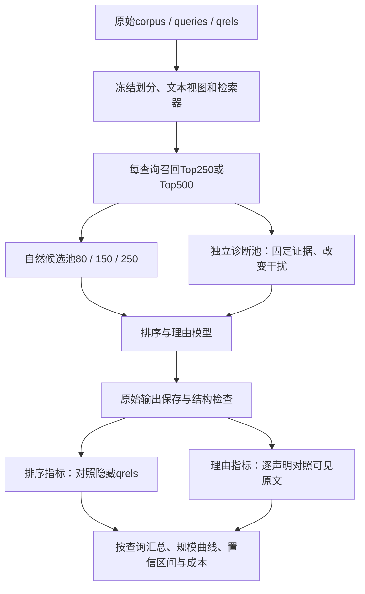

# 选题2实验实施手册：数据、真实样例、候选池、理由标注与指标全流程

日期：2026-10-11。本文按“先利用公开benchmark，研究金融证据重排序＋理由生成”设计，不依赖未获得的业务Task。若最终坚持基金产品重排，还必须补充产品级数据，不能用金融问答实验替代产品实验。

本轮实际完成：读取已缓存FiQA；用一个测试查询演示自定义BM25；下载并对齐一个FinDVer财报样例；生成可检查的输入、独立金标、指标算例与脚本。**没有调用大模型，没有训练，没有产生方法效果比较。下文实验规模是实施建议。** 单查询演示不用于调参，也不构成benchmark结果。

配套：[问题归因与研究范围](选题2_金融产品长候选池_业务归因与实验收敛.md)、[数据审计](research/topic_b/resource_audit_20261010.json)、[FinDVer审计](research/topic_b/findver_resource_audit_20261011.json)。

## 1. 整个实验到底在测什么

任务：给定金融查询q和N个候选文本，输出排序后的20个候选ID，并为每个结果提供简短、有证据的相关性说明。模型可以直接排列ID，无须输出数值相关度。

三个问题分别评估：

1. **选得对、排得好吗？** 使用数据集qrels计算nDCG、Recall等。
2. **说得有依据吗？** 使用输入原文及独立理由标注检查事实、引用、主体、日期和关系。
3. **候选变多后保持得好吗？** 对同一批查询比较不同候选数、token长度和干扰条件下的质量曲线，不能只看集合是否不变。



其中，检索器可以计算BM25或向量相似度来找候选；这只是召回方法。**排序金标准来自qrels，不能把召回分当金标准，也不能拿模型自己生成的分当正确答案。**

## 2. 数据分工：先做两套，不一次铺满所有数据

| 实验数据 | 查询是什么 | 候选是什么 | 已有金标 | 本题角色 |
|---|---|---|---|---|
| FiQA/BEIR | 一个金融问题 | 回答/文档文本 | query—document相关性，当前包为二元正例标签1 | 主排序实验 |
| FinDVer | 一个待核验金融声明 | 财报段落或表格块 | 声明真假、证据块ID、部分解释 | 辅助证据排序与理由核验 |
| SciFact/BEIR | 科学声明 | 文献摘要 | 文档相关性 | 方法成立后可做跨域测试 |
| NFCorpus/BEIR | 医疗/营养相关查询 | 生物医学文本 | 部分划分有分级相关性 | 非金融、仅备选跨域；不要因名字误认为金融 |

FiQA官方划分经本地审计：corpus 57,638条；train 5,500个查询，dev 500，test 648。test共1,706个正相关query—document对，平均每查询2.63条，最多15条。

**因此，Top20并不意味着20条都真正相关。** 任务必须允许“该文本只部分涉及问题”“不能支持这一具体结论”等理由。不要提示模型为每个结果编造正面推荐理由。

FiQA本质上是历史金融问答文本。我们评价“是否忠于输入、是否有助于回答”，不把历史用户回答当作已验证的当代法律、银行政策或投资事实。模型输出理由应描述原文提供的证据，避免提升成普遍金融结论。

数据/工具一次来源：[BEIR官方仓库](https://github.com/beir-cellar/beir)、[FinDVer官方仓库](https://github.com/yilunzhao/FinDVer)。本地审计才是本文具体计数的依据。

## 3. FiQA的三个文件怎么使用

### 3.1 corpus.jsonl：候选内容库

实际记录（完整短文本）：

```json
{"_id":"566392","title":"","text":"Have the check reissued to the proper payee.","metadata":{}}
```

这是文档ID和原文，不包含对某个查询是否相关的信息。同一文档对不同查询的相关性可以不同。

### 3.2 queries.jsonl：查询库

实际测试查询：

```json
{"_id":"8","text":"How to deposit a cheque issued to an associate in my business into my business account?","metadata":{}}
```

中文解释：如何把开给业务伙伴的支票存入自己的企业账户？中文仅用于本文讲解；主实验保留原英文，避免翻译质量成为混杂因素。

### 3.3 qrels/test.tsv：评测答案

该查询的实际标签：

```tsv
query-id	corpus-id	score
8	566392	1
8	65404	1
```

含义：这两条文档是数据集标注的相关文档。不是要求566392必须排在65404前；也不是模型应看到的输入。

未出现在该query的qrels中的候选，标准检索指标按未标注项的默认无增益口径处理，但**语义上不能直接宣布其为已证实负例**。理由是否正确必须重新看原文，不能用qrels=0机械判定幻觉。

存储时用不同命名空间：`query_id=fiqa:q8`、`candidate_id=fiqa:d566392`。已有演示JSON使用较简短的`fiqa:8`等ID；正式实现统一映射并留档。某些评测封装默认移除query ID与doc ID字符串相同的条目，需显式检查，不要误删两个不同实体。

## 4. 数据清理、划分和文本单位

### 4.1 保留原始包，另建处理视图

保存下载URL、日期、SHA-256、预处理版本；原始文件只读。统一ID为字符串，校验重复ID、qrels引用是否存在。不要按“相同文本”随意合并不同文档而不更新标签。

FiQA有38条空文本，且存在对应正相关标注。协议建议：标准比较保留原始语料和qrels，空文档不可提供理由证据；研究子集若排除涉及空正例的查询，必须对所有方法用同一排除表，单独命名为清理子集，保留原始测试结果或明确说明未跑原测试。

### 4.2 不要把文档标签直接继承给每个切片

FiQA qrels标注的是原始文档。第一版建议以整个原始文档作为一个候选单元。若把长文档切成多个chunk，只有部分chunk可能含答案；不能因为原文档相关就把所有子chunk都标为1。

两条可选协议：

- **全文协议（优先）**：文档不切，实际测量token。超预算记录为不可执行，预先定义所有方法共同可执行的查询集。
- **固定短视图协议（资源版）**：提前为所有方法固定同一截取策略，例如最多512模型token，不能随N改变截取。保留原doc qrels但承认“标签对应原文、模型仅见部分文本”的偏差；补查正例证据是否可见。没有证据可见性核验时，只能报告截断协议结果，不能声称它等于原始全文benchmark。

理由评价只准引用实际输入视图。离线评估器看到了完整原文，不得据此原谅模型对被截掉信息的无证据断言。

### 4.3 划分

- train：构造SFT/DPO/GRPO数据；可使用训练qrels辅助采样。
- dev：调提示词、检索参数、长度上限、奖励权重和阈值。
- test：协议冻结后评价；不要根据test错误反复调方法。

原始划分保证查询层面的划分，不自动保证文档或语义近重复隔离。按原划分训练须说明是共享语料的检索设置；若声称新文档泛化，需另设文档/来源分组划分。不要用test或FinDVer官方测试样例生成训练对。

## 5. 怎样构造80、150、250个候选

### 5.1 主实验：自然检索候选池

1. 在完整corpus上建立固定检索器，第一版可用BM25。
2. 每个query一次取Top250，后续若做500档则一次取Top500。
3. 固定排序及并列分处理，取前缀得到`C80⊂C150⊂C250`。
4. 将完整ID列表及召回分写入离线文件；主提示词可不提供召回分，所有方法保持一致。
5. 为每个池生成固定排列种子；不同方法使用同一排列，记录位置。
6. 保存输入token数、字符数、候选长度分布、池内已标正例数、检索器版本和candidate-list哈希。

主实验禁止偷偷把漏召回的正例补进候选池。自然扩容可能增加正例，因此更大候选池的最优Top20可以改变，不能把所有变化都当不稳定。

### 5.2 为什么必须评价候选池召回：真实算例

本轮对query 8，用明确参数的教学BM25（k1=1.2、b=0.75、小写字母数字分词、无词干/停用词处理）跑一次：

- 文档65404排第1。
- 文档566392排第56,019，未进入Top250；其短文本和查询有表达差异，这也说明词法召回的局限，不能由排名推断它语义不相关。
- 三档池内都只有1/2个已标正例，所以PoolRecall=0.5。
- BM25 Top20的Recall@20=0.5，nDCG@20约0.61315。
- 对池内已有正例计算，条件Recall和条件nDCG均为1。

**这不是大模型效果，也不是FiQA全量BM25分数。** 它说明：重排已经把池内唯一正例排第一，标准nDCG仍达不到1；瓶颈在召回阶段。单看条件指标又会掩盖漏召回，所以必须一起展示。

实际文件：[完整250候选输入](research/topic_b/experiment_walkthrough/fiqa_q8_input_top250.json)、[独立金标](research/topic_b/experiment_walkthrough/fiqa_q8_gold_evaluation_only.json)、[召回统计](research/topic_b/experiment_walkthrough/fiqa_q8_retrieval_summary.json)。

### 5.3 归因实验：固定正例与核心候选的诊断池

另建一个明确命名的`controlled_pool`，允许利用金标构造，但不与自然池混合汇报：

1. 固定已标正例与一批核心困难候选，所有规模保留这些候选。
2. 扩容加入已核验不改变查询答案/关键关系的干扰项。
3. 困难干扰为同主体不同年份、近似指标、同领域不同实体等；容易干扰为明显不相关文本。
4. 只依据“没有qrels”得到的候选记为未标注干扰，不能声称是已核验负例。对核心诊断子集人工复核。
5. 同数量固定证据增加长度；相近token总量增加实体数；固定N/L改变干扰相似度。每个实验只回答一个主要归因问题。

这是金标感知的诊断协议，不是自然检索效果。目的在于让新增正例和检索召回变化不再掩盖理由退化。

## 6. 大模型具体看到什么、输出什么

### 6.1 输入模板

```text
任务：依据查询对候选文本排序，输出恰好20个不同的候选ID。
相关性：文本是否提供回答查询所需的信息，而不只是主题或词语相似。
对每个结果给出简短相关性说明，可说明其局限或证据不足。
不得因为结果进入Top20就强行声称其完全相关。
事实声明必须以提供的文本为依据；引用使用candidate_id和span_id。
只能返回候选池中的ID。不要引入其他候选的事实作为当前候选的属性。

Query: ...
Candidates: [...]
```

候选可预先标注句子/表格块ID。普通段落保留原文偏移；表格不要用按句号切分的方式破坏表头。主实验所有方法使用同一编号后的视图，防止编号本身成为额外改进因素。

### 6.2 输出模板

```json
{
  "ranking": [
    {
      "rank": 1,
      "candidate_id": "fiqa:d566392",
      "relevance_assessment": "partial",
      "reason": "该回答提出重新开具给正确收款人的支票，提供了处理收款人问题的办法，但未说明银行的具体办理要求。",
      "evidence_refs": [{"candidate_id":"fiqa:d566392","span_id":"s1"}]
    }
  ]
}
```

此处仅演示一行格式，不是完整20条或模型实测输出。`relevance_assessment`是模型判断，不是qrels金标；不用它直接代替排序评测。说明银行通用政策、保证能存入、增加未出现的办理期限等，均不能从这条短文本推出。

### 6.3 原始输出与解析结果分开保存

保存raw response、解析JSON、输入哈希、请求时间、model版本、参数、usage、finish_reason、失败原因。原始输出不可被修复逻辑覆盖。

程序检查：可解析、20条、ID存在、无重复、rank连续、引用属于可见输入。引用有效只能证明“地址合法”，不能证明“内容支持理由”。

失败策略预先固定：主端到端指标把不满足预定义结构协议的请求视为失败，失败感知排序分记0；另列有效输出上的条件分。标准检索诊断可以对合法的短列表算nDCG，但要同时报告不足20，不能据此判定任务完成。若启用重试/回填，作为单独系统配置，计入成本并保留首次失败率。

## 7. FinDVer如何改造成辅助实验

### 7.1 读取字段与注意事项

`statement`作查询；`report`定位财报；财报`context`中的每个`id/context/type`作候选；`relevant_context`为已标证据；`entailment_label`只评价最后的声明核验结果。

`false`声明同样有相关证据，因为证据可以反驳声明。不得按“是否支持声明为真”定义检索相关性。

实际核验：testmini 700条，test 1700条；testmini数值子集用`explaination`拼写变体，需兼容；test数值子集600条解释为空；两个split共享155份报告。规范化后1800条非空解释。默认把这些官方集合用于外部评估，不据此设计无泄漏训练。

### 7.2 一个已完成证据对齐的真实样例

`example_id=ie-val-0`，`report=NJR-2024-02-06_10-Q.json`，该报告有304个context块。待核验声明混合了2023-12-31的公允价值资产、太阳能售后回租债务和估值层级。标签为false，证据ID为89、90、93。

逐块核对：

| 块ID | 原文事实的中文转述 | 可以识别的错误 |
|---|---|---|
| 89 | 2023-12-31售后回租债务账面值296.3百万美元；2023-09-30为278.4百万美元 | 把较早日期数值当作较晚日期 |
| 90 | 2023-12-31债务披露在Level 2 | 估值层级关系 |
| 93 | 资产公允价值表Level 1列为32,253千美元，Total列为42,146千美元 | 把分项列当成总计列 |

因此模型即使找到了正确表格，仍可能在理由中引用错列；这正好区分“检索正确”与“理由正确”。本轮仅核对这个样例的相关块，没有核验全数据标注。

文件：[对齐后的真实记录与三个证据块](research/topic_b/experiment_walkthrough/findver_ie_val_0_aligned_example.json)，内含原始SEC链接及本地财报哈希。

### 7.3 两条FinDVer轨道

**自然轨道**：对每条声明，从本报告的全部块检索TopN，再重排和说明各块为何有助核验。段落不够250的报告可在预先定义的长度合格子集中测试；公布保留/排除数量，不复制块凑数。跨报告补充候选属于另一种任务，需单独命名。

**受控轨道**：保留全部已标证据，逐步添加本报告的其他块。测试答案证据固定时干扰是否影响重排理由。可另用同公司不同报告期做更难条件，但那会改变跨报告任务，需明确。

候选块不强制统一500字；长表格必须保留表头和单位。若重切，建立父块到子块映射并重新定位证据，不能将父块金标复制给所有子块。

### 7.4 评分边界

以Evidence Recall@20和All-Evidence-Hit@20为主；二元证据nDCG只作补充，因为原证据可能不穷尽，且多块常需组合才能核验。可在Top20后接同一个冻结核验器，评价最终真假准确率；该下游结果不能替代重排和理由指标。

对核验器固定提示词、模型、解码参数和输入预算；当Top20总长超过预算时统一策略，否则不同排序可能因截断获得不同证据。不要把金标解释直接传给核验器。

## 8. 理由金标怎样建立

### 8.1 为什么qrels不够

qrels只表明文档与问题的相关性，无法判定模型理由中的日期、数值、关系是否正确。一个相关文档可以被错误解释；一个不相关文档也可以被正确说明“缺少所需信息”。后者理由忠实，但排序可能较差，必须双轴评价。

### 8.2 标注单位

一条理由拆成最小事实/相关性断言。例如“该表给出2023年总资产32,253千美元，因此可用于比较年度变化”至少包含日期、数值所属列和用途等可分别核验的断言。标注保存原始reason、claim文本或字符区间、引用、标签、错误类型、裁决说明。

对每项断言标：

- `S/supported`：可见原文支持，实体、日期、数值单位和关系正确。
- `C/contradicted`：可见原文明示与之冲突。
- `U/unsupported`：原文不足以支持，没有必要断言其在现实中绝对为假。
- `X/needs_adjudication`：标注者无法判断，交由裁决；不直接等于U。

另评`useful_to_query`：是否具体解释该文本与查询的联系或局限；“很相关、信息丰富”这类空泛理由即使没有明显错误，也不能算有效解释。

### 8.3 标注例子（说明性假想输出，不是实测）

对FinDVer块93：

| 理由声明 | 标签 | 错误类型 |
|---|---|---|
| 该表总计列为42,146千美元 | S | — |
| 该表总资产为32,253千美元 | C | 表格列/指标归属 |
| 公司资产增长由新收购推动 | U | 无来源新增因果解释 |
| 这份报告质量很高 | 不作为有效证据理由 | 空泛/偏离查询 |

对块89：“2023-12-31值278.4百万美元”是日期归属错误；数值出现在原文不等于引用正确。对FiQA短回答，把“建议重新开支票”升级为“银行必须接受背书支票”属于无支持推断。

### 8.4 人工与自动评价怎么结合

规则负责ID、span存在、原文引用一致、简单数值格式。支持性需要完整语义核验，可用固定LLM评估器初筛，但必须用人工样本估计其误差。

建议先随机分层抽600条理由做双人标注校准，覆盖方法、长度、正确/可疑类型；不能只挑失败案例估计总体错误率。根据真实标注耗时再扩大。完整请求零错误率需要检查该请求全部20条理由，不能用抽查5条推断。

一个完整人工核心集可选20个测试查询×2个规模×3个方法×20条=2400条理由。若每人每条需20—40秒，双人原始工作量约27—53小时，另加裁决；包含复杂表格的耗时可能更高。经费不足先做更小核心集，并报告不确定性，不虚称所有输出都经人工审核。

两人独立、隐去方法名称；计算原始一致率及Cohen's kappa等，报告类别分布，裁决后形成金标。评估器与训练teacher尽量分离，并固定版本；不能仅用同一个teacher奖励再由同一个teacher宣布方法最好。

**BLEU、ROUGE或与参考解释的文本相似度不作为理由真实性主指标。** 正确理由可以有多种表达；词面相近也可能恰好错了年份或关系。

## 9. 每个指标具体怎样计算

统一记号：q为查询；Gq为全语料已标正相关文档集合；Cq,N为当前候选池；Rq,20为模型输出的前20个不同合法ID；r(d)为qrels等级。所有主排序指标先逐查询算，再在预先固定的全部查询上宏平均。重复实验先在同一查询内平均，不能把候选多的查询赋予更大权重。

### 9.1 nDCG@20：相关结果是否靠前

采用BEIR/pytrec_eval常用的trec_eval线性增益协议：

`DCG@20 = Σ(i=1..20) r(d_i) / log2(i+1)`。

`IDCG@20`：将该查询**全部qrels**按等级降序排列后计算理想DCG，最多取20条。

`nDCG@20 = DCG@20 / IDCG@20`。

不是按模型输出中出现的正例重新构造IDCG，也不是只用当前池中的正例作为主指标分母。否则漏召回会被隐藏。没有正例的查询需预先单列策略；本文FiQA官方测试查询都有正例。

注意常见公式`2^r-1`是另一种增益设置。FiQA只有0/1时二者相同；对NFCorpus等分级标签会不同，必须固定实现。一次来源：[trec_eval源码](https://raw.githubusercontent.com/usnistgov/trec_eval/master/m_ndcg_cut.c)、[ir-measures参数说明](https://ir-measur.es/en/latest/measures.html)。

**手算例（合成排序，不是模型结果）**：只有A、B两个相关文档，模型把它们排第2和第5，其余前20增益为0。

```text
DCG  = 1/log2(3) + 1/log2(6) = 1.01778256
IDCG = 1/log2(2) + 1/log2(3) = 1.63092975
nDCG@20 = 0.62405052
```

主表报nDCG@20；为对齐常见文献可补nDCG@10，但不得拿不同截断、不同候选池的分数直接比较。

### 9.2 Recall@20：最终找回多少已标相关文档

`Recall@20 = |Rq,20 ∩ Gq| / |Gq|`。

上例两个正例都进Top20，Recall=1，即使nDCG只有0.62405；这说明“找回全部”和“排在前面”不是同一件事。

真实query 8示例只找回一个，Recall=0.5。不能因为当前池只有一个正例，就把主Recall分母改成1。

### 9.3 PoolRecall@N：召回阶段给重排留下多少机会

`PoolRecall@N = |Cq,N ∩ Gq| / |Gq|`。

由固定检索器与候选池决定，所有在同一池上的重排方法值相同。无新增文档的reranker满足`Recall@20 ≤ PoolRecall@N`。每个规模都报，以解释性能上限。

辅助指标：`ConditionalRecall@20 = |Rq,20 ∩ Gq| / |Cq,N ∩ Gq|`；只回答池内正例找回多少。池内无正例时为NA，报告NA数量，不设为1。

类似可报告`ConditionalPoolNDCG`，IDCG限制为池内已标正例，但必须明确名称并与全语料nDCG并列。本文真实例条件分1、全语料分0.61315，正好显示二者的差别。

### 9.4 P@20与MRR@20：辅助解释，不当唯一主指标

`P@20 = 已标正例命中数 / 20`，短输出分母仍为20。FiQA每查询正例稀少，P@20偏低可能是标签稀疏，不能据此说其余所有内容实际无关。

`RR@20 = 1 / 首个正例名次`；前20无正例则0。所有查询的RR均值为MRR。上例P=0.1、RR=0.5；真实query 8示例P=0.05、RR=1。

MAP不是本题最必要指标，可留作标准工具补充；本研究主表不必塞满高度相关的排序指标。选择nDCG@20＋Recall@20＋PoolRecall即可覆盖最关键问题。

### 9.5 理由支持率与不支持率：最核心的解释指标

在已裁决断言中计数S、C、U：

`SupportRate = S/(S+C+U)`。

`UnsupportedRate = (C+U)/(S+C+U)`，同时分别报告ContradictionRate和InsufficientSupportRate。

若有6项断言，4支持、1矛盾、1不足支持：SupportRate=66.67%，UnsupportedRate=33.33%。不能把“有合法引用”直接计作S。

没有任何实质断言时该项为NA，不是100%。必须同时看有效理由覆盖；X待裁决数量另报，不能悄悄移除难判例而提升结果。正式人工主集尽量裁决全部X。

建议报告两种汇总：先每查询算再平均的宏平均为主；所有断言合并的微平均为辅。理由较长的方法会产生更多断言，微平均可能改变权重；保持统一理由长度要求并报告实际长度。

### 9.6 错误候选率与有效理由覆盖：防止平均数掩盖问题

`AffectedItemRate = 至少一项C/U的输出候选数 / 已输出候选数`。

`UsefulFaithfulCoverage@20 = 有非空、具体、全部受支持说明的合法结果数 / 20`。

例如输出20条，12条全部受支持且有用，3条含错误，5条空泛：错误候选率15%，有效理由覆盖60%。二者应一起看。只输出4条全部正确时，覆盖最多20%，不会被当作任务已完成。

弱相关文档的准确局限说明可以算有效理由，前提是具体且有据；它不因此变成排序正例。覆盖是解释覆盖，不是相关文档Recall。

### 9.7 引用与来源归属：分三层，不混成一个准确率

1. `ReferenceValidity`：地址存在且属于可见输入的引用数/所有引用数。程序检查。
2. `CitationPrecision`：经语义核验确实支持对应断言的引用数/所有引用数。非法引用也算失败。
3. `ClaimCitationCoverage`：至少有一条有效且支持该断言的引用的断言数/需要证据的断言数。

一条声明挂很多无关引用不能提高CitationPrecision；只对容易声明引用也不能提高Coverage。若引用集合需要组合推理，注明采用集合级充分性评价，不强求每个片段单独证明整句。

来源错配、日期错配、数值单位、表格列、关系端点、无据因果等作为错误子类型；可多标签，比例相加可能超过总错误率。`wrong_owner`不能只凭“引用了别的候选”判错：允许显式跨文档比较时可能合理；只有事实被错误归属或违反预先定义引用范围时才算错。

### 9.8 完整性和严格请求通过率

逐项报ParseRate、Exactly20Rate、UniqueIDRate、InPoolRate、ValidCitationRate、NormalStopRate。它们的分母都是全部尝试请求，不是仅成功请求。

预定义严格通过：结构通过＋20个合法不重复结果＋所有理由有实质内容且无C/U＋需要的证据引用合格＋正常结束。取通过请求数/全部请求数。

严格通过率只在完整审核的请求集上报；自动评估器得到的结果标为“自动估计”，不能与人工严格通过率混写。有限次无错误不等于证明零错误容量。

### 9.9 排列稳定性与扩容稳定性

两个合法Top20集合A、B：

- `Overlap@20 = |A∩B|/20`；交集19则95%。
- `Jaccard = |A∩B|/|A∪B|`；同例为19/21≈90.48%，二者不能混称。
- 共同候选顺序可用Kendall tau-b，必须报共同候选数量；集合不同情况下仅对交集算相关会忽略丢失候选，所以需与Overlap同时展示。

以上主用于**同一池改变排列**。自然扩容出现更好候选时换人是合理的；只在已核验的弱干扰扩容诊断池中，把不必要变化作为稳定性问题。

理由稳定性另外计算：对相同query—candidate的固定核心对，比较不同条件下正确断言保持率、不受支持率。文字措辞改变不等于错误；需要比较可规范化的事实断言。始终重复同一个错误不能算成功。

### 9.10 规模退化：论文最重要的差值

以80和250为例：

`ΔU = UnsupportedRate_250 - UnsupportedRate_80`，越小越好，同时比较250档绝对值。

`ΔnDCG = nDCG_250 - nDCG_80`，在受控池有解释意义；自然池还受正例召回变化影响。

候选方法要在降低U及ΔU的同时，维持排序质量与有效理由覆盖。预先在dev确定可接受排序下降界限，例如绝对0.01作为候选非劣界限，最终值须说明依据；不能看完test再选择有利阈值。

对联合负担，固定同一批解释对象，算：

`Interaction = (U_joint,250-U_joint,80) - (U_reason_only,250-U_reason_only,80)`。

若为正且区间支持该差异，表示联合设置在此实验中放大退化。必须保证两组理由对象、输入范围及输出长度可比；对全池与局部解释分别比较，不把上下文缩短效果混进任务数量效果。

### 9.11 FinDVer专用指标

- `EvidenceRecall@20 = Top20命中的已标证据块数 / 所有已标证据块数`。
- `AllEvidenceHit@20 = 1[所有已标证据都在Top20]`，再按查询平均。真实样例三个块找回两个时Recall=2/3，而AllEvidenceHit=0。
- 二元Evidence nDCG使用证据块标签，但承认未标块可能也有帮助。
- 冻结下游核验器的`Accuracy = 正确真假预测数/全部声明数`；补Macro-F1及真假混淆矩阵，输出异常单列为失败，不当作false预测。
- 给核验器全部标注证据的oracle条件是诊断参照，不混入主流程；有限标注可能不穷尽，不能说它一定是理论最高分。

### 9.12 成本

每个逻辑请求记录所有物理调用的输入/输出token总和、推理token（如API单独提供）、重试次数、端到端墙钟时延和单调用时延。汇报均值、p50、p95；并行局部调用降低墙钟延迟，不等于减少token开销。

费用用实际供应商用量口径：`Σ input_tokens×input_price + Σ output_tokens×output_price`，缓存命中和其他计费项分别核算。训练另报峰值显存、GPU小时、样本数、总训练token和优化配置。本文不假设固定API价格或24GB长序列训练吞吐。

## 10. 哪些模型/流程作对照

| 编号 | 方法 | 排序指标 | 理由指标 | 目的 |
|---|---|---|---|---|
| B0 | 固定BM25召回顺序 | 有 | NA | 确认重排是否有增益 |
| B1 | 大模型只输出Top20 ID | 有 | NA | 排序-only对照 |
| B2 | 同模型联合输出排序＋理由 | 有 | 有 | 原始问题基线 |
| B3 | B1先排序，再逐候选局部解释 | 有 | 有 | 任务解耦强基线 |
| B4 | 联合输出＋明确证据引用/定义提示 | 有 | 有 | 排除仅靠提示就解决的情况 |
| M1 | 普通SFT的同框架 | 有 | 有 | 排除普通域适应收益 |
| M2 | 困难干扰/对照训练SFT | 有 | 有 | 测方法核心贡献 |
| M3 | M2＋DPO或GRPO | 有 | 有 | 后续增量，非第一阶段必做 |

第一轮先做B0—B3；有明确剩余问题再加B4和训练组。算法比较尽量用相同基座模型、相同池和视图；API大模型是强参考，不能把基座差异写成算法收益。

若方法使用分组，所有组均处理原池候选，并与同样分组但没有新训练的对照比较。排序/聚合过程产生的额外调用全部计入。最终Top20用候选自己的原文或必要的成对原文解释，不能只依赖可能失真的中间摘要。

### 10.1 公平比较理由的两种集合

- **端到端集合**：每个方法解释自己选出的Top20，衡量实际系统输出。选集变化会影响理由难度。
- **固定对象集合**：预先固定20个候选或证据核心对象，各方法在不同池规模下解释同一批对象。用于识别理由能力变化；集合的构造须在test评价前冻结。

两者都做，不能用“改选了更容易解释的文档”冒充同样对象上的解释提升，也不能只看交集而隐藏方法丢掉的困难结果。

## 11. 如果做后训练，数据怎样流动

1. 只从FiQA train查询生成自然/诊断候选池；dev/test隔离。
2. 使用训练qrels标注排序正例；未标注候选只是采样负例假设，对事实错误训练对需要额外核验。
3. teacher基于可见文本生成短理由；训练阶段可给teacher训练金标辅助筛选，但学生正式输入不含qrels或参考答案。
4. 规则过滤非法引用/错ID；抽取式证据优先；语义支持通过独立检查和人工样本校准。
5. 构造相同query/candidate证据不变但干扰不同的配对；另构造显式标记的合成日期/主体变更，重新标注。
6. SFT样本保存`messages, target, provenance, split, evidence`。每条target能回溯原文和标签来源。
7. DPO样本保存`prompt, chosen, rejected`；同一prompt下尽量固定排序和文风，仅改变证据错误，避免模型只学长度/格式偏好。另设排序偏好组，不把两个目标混在一个不可解释差异中。
8. GRPO如使用，以可验证的排序、证据正确和有效覆盖构造奖励；对未知证据允许谨慎说明。单纯奖励没有错误会诱导不输出理由，需要覆盖约束。
9. 训练原样本及其所有变体留在同一split。FinDVer官方评估样例不进入teacher训练生成。

24GB先做小模型、短局部/小组上下文的显存与吞吐试验。不能因为参数能放进显存就承诺能训练整段250候选。若仅训练局部模块、用分组应对长池，论文结论是系统级规模泛化；直接长Listwise能力需独立评测。

最重要的消融：无困难干扰、无事实变化对照、无证据监督、只普通SFT、只提示词、局部解释。先决定能回答研究问题的少量消融，避免无意义叠加模块。

## 12. 实验规模、统计及论文表格

### 12.1 三阶段推进

| 阶段 | 建议规模 | 产物 |
|---|---|---|
| 数据/提示验证 | FiQA dev中10—20查询，2规模；FinDVer少量可对齐样例 | 查输入预算、解析、标签误用、理由标注难度 |
| 归因试验 | dev中50查询，80/150/250三档，3个主要设置，先单次 | 450个逻辑设置；挑出有信号的长度/干扰/联合任务因素 |
| 冻结正式实验 | 预算足够使用648个FiQA test查询；否则预先固定并公布150查询子集 | 全量或明确命名的子集主表，不把子集分数当全量 |

例如150查询×3规模×4配置=1800个逻辑设置，未包括重试和排列重复。若每个平均输入50k token，单次调用配置的量级约90M输入token；逐条解释有额外调用且输入长度结构不同，须按真实usage重算。先测10查询用量，不能仅以“1800次调用”估预算。

排列与重复：主表可先固定一个检索顺序；稳健性子集另外做3种固定排列×2次重复。不同排列测位置敏感性，同排列重复测采样/服务变化，分开汇总。temperature=0也不自动保证整个服务绝对确定性。

FiQA为英文，不能把其522字符的中位数直接当成500中文字的token长度。每种模型使用其实际tokenizer或API usage报告。候选数量是横轴之一，token数和文本类型也必须记录。

### 12.2 统计检验

每个查询保留各条件结果，方法差值配对比较。建议以query为重采样单位做bootstrap置信区间；同一查询的20条理由、多个排列和重复不是相互独立的查询。涉及同财报多声明时进一步按报告/公司聚类，或说明聚类选择。

置信区间与均值一起报告，不只列最好一次。预先确定主指标和比较，探索性多重对比单列。没有重复/足够样本时不宣称容量阈值。

### 12.3 最终论文建议五张表/图

1. 数据表：查询数、候选数、token分布、池内正例数、缺失/排除情况。
2. 排序主表：方法×规模的nDCG@20、Recall@20与共同PoolRecall。
3. 理由主表：SupportRate、AffectedItemRate、UsefulFaithfulCoverage、完整请求通过率；注明人工/自动。
4. 归因图：固定证据条件下，随token、实体数、相似干扰和任务设置的错误变化。
5. 成本和消融表：总token/延迟/训练资源，以及去掉核心约束后的差值。

不要只画随候选数量增加的单条曲线，就将其命名为“长度因果效应”。

## 13. 推荐保存的文件结构

```text
experiment/
  manifest.json                  # 原始包hash、预处理、模型/协议版本
  corpus_view.jsonl              # doc_id与可见text/span映射
  queries_train_dev_test.jsonl   # 各split另存亦可
  qrels_original/                # 原始排序标签，只供训练构造/离线评估
  pools/natural/*.jsonl          # qid,N,doc_ids,检索分,排序seed,hash
  pools/controlled/*.jsonl       # 干预类别、核心证据、额外审核标签
  requests/*.jsonl               # 模型真正收到的内容，不含测试金标
  outputs/raw/*.jsonl            # 原始响应、usage、finish_reason
  outputs/parsed/*.jsonl         # 解析结果、失败标记
  annotations/*.jsonl            # claim,S/C/U/X,引用、错误类型、裁决
  metrics/per_query.jsonl        # 逐查询各条件分数，不只存均值
  metrics/aggregate.json         # 均值、区间、样本量、排除数
  training/                     # 来源可追溯的SFT/偏好数据
```

`per_query`至少包含dataset、split、qid、pool_type、N、input_tokens、method、model_version、permutation_seed、repeat_id、valid_output、nDCG、Recall、PoolRecall、S/C/U/X计数、有效理由数、usage、latency。所有标签和实际可见文本通过稳定ID连接。

## 14. 本轮已生成的可运行教学材料

- [构造与计算脚本](research/topic_b/build_experiment_walkthrough.py)：纯Python标准库、读取缓存、无网络或模型调用。
- [FiQA真实250候选输入](research/topic_b/experiment_walkthrough/fiqa_q8_input_top250.json)：没有qrels。
- [FiQA评估专用金标](research/topic_b/experiment_walkthrough/fiqa_q8_gold_evaluation_only.json)：与输入分离。
- [真实查询的BM25召回统计](research/topic_b/experiment_walkthrough/fiqa_q8_retrieval_summary.json)：仅单查询教学例。
- [nDCG等指标手算fixture](research/topic_b/experiment_walkthrough/metric_arithmetic_example.json)：合成排名，非模型输出。
- [FinDVer真实记录与已对齐证据](research/topic_b/experiment_walkthrough/findver_ie_val_0_aligned_example.json)：只有该例完成证据核验。

工作区根目录执行：

```bash
python3 Graduation_Thesis/research/topic_b/build_experiment_walkthrough.py
```

它会重新生成教学文件，并校验理想排序nDCG=1、合成例Recall=1、MRR=0.5及空正例候选池的NA处理。源码中的指标实现用于说明和自检；正式论文固定BEIR/pytrec_eval等标准实现版本并交叉核对，不能把教学脚本当成已完成完整评测系统。

## 15. 第一批实验的明确交付标准

第一批不要求证明新方法优越，而要求完整跑通：

1. 所有查询和候选可回溯，输入不泄露评测标签。
2. 自然候选池嵌套关系正确，PoolRecall可核算。
3. 模型输出能分开报告排序、理由、格式和成本。
4. 至少一小批理由完成双人核验，清楚区分不相关与无支持理由。
5. 找到可重复的规模/干扰效应，或者如实发现问题主要由提示词、召回或截断造成。

完成这些后，再决定后训练是否有必要及采用哪种约束。这样论文的方法由测出来的问题支撑，而不会先选GRPO再倒找理由。
