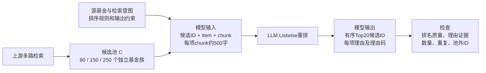

# 选题2导师汇报PPT逐页大纲

编写日期：2026-10-12。按九部分组织，建议正文23页，约18—22分钟。若只有10—12分钟，文末给出压缩方案。

汇报主线：**业务中候选池扩容后出现理由错误。研究用公开金融披露构造item＋chunk任务，先分析失效因素和错误类型，再验证针对理由证据绑定的小模型后训练。**

本材料是逐页制作和讲述大纲。业务结果来自已提供的报告。文献发现、已取得的数据和拟开展的实验分别标明，当前没有本项目模型评测或训练效果。

## 页码与九部分对应

| 部分 | 页码 | 内容 | 建议时间 |
|---|---|---|---|
| 封面 | 1 | 题目与一句话任务 | 20秒 |
| 一、题目来历 | 2—3 | 业务输入输出、实际错误 | 2分钟 |
| 二、正式题目 | 4 | 研究对象、任务与目标 | 1分钟 |
| 三、三个研究问题 | 5 | 为什么、是什么、怎么改善 | 1分钟 |
| 四、RQ1文献综述 | 6—7 | 长度与绑定机制、金融特征 | 2分钟 |
| 五、RQ2文献综述 | 8—9 | 错误分类与评测方法 | 2分钟 |
| 六、RQ3文献综述 | 10—11 | 模块方法与后训练近邻 | 2分钟 |
| 七、数据选择 | 12—13 | 企业数据限制、公开数据替代与样例 | 2分钟 |
| 八、实验方案 | 14—21 | 六组实验、指标、资源与执行口径 | 6—7分钟 |
| 九、价值与时间线 | 22—23 | 贡献候选、阶段交付与导师讨论 | 2分钟 |

正文每页以一个中心判断为主。文献页最多展示4—5篇代表作，完整索引和XMind放在附录入口。所有实验效果图都只能画坐标与待验证假设，不能填入模拟效果冒充结果。

## 第1页：封面

**标题：** 面向金融信息条目长候选池重排序的理由证据一致性分析与后训练优化研究

**副标题：** 公开金融item＋chunk任务的选题与实验计划

页面内容：姓名、专业、导师、汇报日期。底部一句话：

> 研究候选池扩容时，模型是否将理由归到错误条目或证据，以及如何用后训练改善。

**讲述要点：** 本次汇报的是研究问题、文献依据、公开数据和实施方案，目标是确认课题范围及实验优先级。

## 第一部分：题目的来历

### 第2页：金融搜索Agent的重排任务

**中心信息：** 上游返回很多产品及资料，LLM需要同时选Top20、排序并解释。

**页面文字：**

- 上游多条检索链路返回候选，每项包含产品item及其证据chunk。
- 模型输入还包含源产品/检索意图、排序规则和输出约束。
- 模型输出有序Top20及每项理由，实际系统使用结构化理由码。
- 业务估计每项名称约10字，chunk约500字。250项仅名称与正文约127,500字符，实际token数需要另测。

**配图：模型输入与输出。** 以下图可直接用于PPT制作，业务说明采用示意结构，不能标成原始Task JSON。



**建议图下放两个示意框：**

```text
输入：
源基金：嘉实中证全指集成电路ETF联接A
候选：{id, 产品名称, 关系字段/持仓等信息, chunk}
要求：按任务规则选出并排序Top20，生成有输入支持的理由

输出：
[{rank: 1, candidate_id: ..., reason_codes: [...], reason: ...}, ...]
```

**讲述要点：** “模型承担两项职责：决定哪些产品更合适，以及解释为什么。业务中的问题主要出现在第二项职责。”

### 第3页：候选扩大后，排序集合保持但理由开始出错

**中心信息：** 业务报告显示排名与理由可靠性可以分离。

**页面主表：**

| 报告中的模型 | 80项 | 150项 | 250项 |
|---|---|---|---|
| GPT-5.5 | 严格通过 | 严格通过 | 13条错误`ETF_LINK`理由码 |
| DeepSeek-V4-Pro | 严格通过 | 严格通过 | 1条错误`ETF_LINK`理由码 |
| JoyAI-750B | 仅输出10条 | 严格通过 | 仅输出4条 |

**右侧放一例错误解释：**

> 候选本身是ETF联接基金，不等于它与源基金存在输入定义的ETF/联接对应关系。模型把“产品自身属性”写成了“两个产品的特定关系”。

**辅助证据：** GPT在250项时与150项Top20保持率95%，DeepSeek为100%。这说明已选集合较稳定，但理由仍可能有错误。

**页脚必须保留：** 单一query，每模型每档1次。NDCG是业务规则代理分。候选构成随扩容变化。报告作为问题动机，不能据此证明纯长度因果或普适容量上限。

**讲述要点：** “我们希望解释并改善这种选对条目、却说错理由的现象。同时，少推和格式问题也要测，但不能都归为事实幻觉。”

## 第二部分：正式说明题目

### 第4页：研究对象、任务与优化目标

**正式题目：**《面向金融信息条目长候选池重排序的理由证据一致性分析与后训练优化研究》

**页面分四块：**

| 项目 | 定义 |
|---|---|
| 输入 | 公开金融问题q，候选item、来源信息及chunk |
| 排序对象 | 公司披露事项、实体或财务指标条目 |
| 输出 | TopK条目及次序，简短理由，明确证据引用 |
| 优化目标 | 候选池扩容时提高理由支持和归属正确性，同时保留排序质量与有效解释覆盖 |

**相关性解释：** 对公开问题的证据效用。评测相关性来自qrels或人工标注，模型只负责预测排序。

**范围说明：** 金融披露分析仍是金融场景。题目不再限定基金产品，也不以投资收益或推荐适当性为目标。

**讲述要点：** “核心任务结构保持item＋chunk重排和理由生成。数据范围调整为可公开复现的公司披露资料。”

## 第三部分：拆解三个研究问题

### 第5页：三个研究问题及对应证据

| 研究问题 | 具体要回答什么 | 对应产出 |
|---|---|---|
| RQ1 为什么失效 | 长度、候选数、主体数、相似干扰、位置和联合任务，哪些因素影响理由错误？金融字段约束起什么作用？ | 受控对照与错误影响因素分析 |
| RQ2 出现什么 | 无依据、矛盾、主体/期间/指标错绑、出处错误如何区分？排名稳定时理由是否仍失真？ | 标注协议与多维评测 |
| RQ3 如何改善 | 针对金融绑定错误的SFT/偏好训练，是否优于规则、局部解释和普通抗干扰训练？ | 小模型后训练方法与消融 |

**图示建议：** 三个并排问题框，框内分别写“控制输入因素”“核验输出错误”“对照训练方案”，下方对应“数据”“指标”“实验”。

**讲述要点：** “先确认错误及原因，再确定训练目标。金融是否放大这些错误是研究假设，不能提前当作结论。”

## 第四部分：RQ1文献综述

### 第6页：长输入、证据位置与实体绑定

**中心信息：** 候选池扩容同时改变长度和需要区分的对象数，必须分开研究。

| 方向与代表作 | 已经研究什么 | 对本题的启发 |
|---|---|---|
| Lost in the Middle，TACL 2024 | 关键证据位置影响长上下文表现 | 设置前/中/后证据位置对照 |
| Same Task, More Tokens，ACL 2024 | 保持任务核心信息，研究输入长度影响 | 固定决定性证据，增加其他上下文 |
| Context Length Alone Hurts…，Findings EMNLP 2025 | 正确获取证据后仍可能出现长度退化 | 区分“找不到”和“找到后用错” |
| How do LMs Bind Entities in Context?，ICLR 2024 | 激活干预研究实体—属性绑定 | 将错主体、错指标视为可检验的绑定假设 |
| Mixing Mechanisms，2025预印本 | 分析绑定机制并控制实体数量与长度 | 近固定L改变N或主体数 |

**建议配图：** 两组控制示意。一组保持20个item，chunk变长。另一组保持近似总token数，item从20增至50。图下注明“拟做对照”。

**讲述要点：** “长池不仅更长，还包含更多相似对象。我们的重点是判断错误更受哪一项影响。”

**来源放备注：** [Lost in the Middle](https://aclanthology.org/2024.tacl-1.9/)、[Same Task](https://aclanthology.org/2024.acl-long.818/)、[Context Length](https://aclanthology.org/2025.findings-emnlp.1264/)、[Binding](https://arxiv.org/html/2310.17191v1)、[Mixing](https://arxiv.org/html/2510.06182v1)。

### 第7页：金融证据约束与相似干扰

**中心信息：** 金融相关性需要匹配主体、期间、指标和口径。相似内容可能来自错误来源。

| 代表作 | 研究内容 | 本题要迁移的部分 |
|---|---|---|
| FinCARDS，Findings ACL 2026 | 金融证据卡片、字段约束及稳定重排 | 金融字段约束，作为强基线 |
| FinRank，2026预印本 | 来源敏感金融检索，跨公司/期间困难负例 | 公开问题与相似干扰构造 |
| NoLiMa，ICML 2025 | 减少字面匹配，研究关联检索和干扰 | 关键词相同但语义/主体不符的对照 |
| Sufficient Context，ICLR 2025 | 区分证据充分与不足 | 保留证据组与缺证据组分开 |
| The Power of Noise，2024作者版本 | 不同噪声作用不同，随机噪声有时有益 | 不预设所有加长都导致单调退化 |

**页内小例子：** “FY2024收入”需同时匹配公司、财务期间、收入定义、币种/单位。另一个公司或FY2023的同类数值不能直接作为理由。

**讲述要点：** “已有论文支持金融出处和约束问题，但尚需在我们的排序＋理由任务中测试扩容影响。”

**来源放备注：** [FinCARDS](https://aclanthology.org/2026.findings-acl.1244/)、[FinRank](https://arxiv.org/abs/2608.07400)、[NoLiMa](https://arxiv.org/html/2502.05167v1)、[Sufficient Context](https://arxiv.org/html/2411.06037v1)、[Power of Noise](https://arxiv.org/html/2401.14887v1)。

## 第五部分：RQ2文献综述

### 第8页：理由错误的分类与金融长文检测

**中心信息：** “幻觉”需要拆成可以标注的错误，才能确定训练目标。

| 方向与文献 | 已经做什么 | 本题对应问题 |
|---|---|---|
| RefChecker，2024作者版本 | 陈述拆分，支持/中立/矛盾判断 | 理由中的事实是否被证据支持 |
| RAGTruth，ACL 2024 | RAG输出的细粒度错误标注 | 无依据及矛盾的标注参考 |
| FinDVer，EMNLP 2024 | 长金融文档中的可解释声明核验 | 数值、知识与证据解释的金融核验 |
| PHANTOM，NeurIPS 2025 | 金融长上下文幻觉检测，控制长度和位置 | 金融长池评测设计的邻近依据 |

**本题拟定错误分类：** 无依据、矛盾、主体错绑、期间错绑、指标/单位/口径错配、出处错误。另报少推、重复、池外ID及截断。

**讲述要点：** “金融长文幻觉检测已有研究，但检测一段回答与解释一组有排名的item仍有任务差异。”

**来源放备注：** [RefChecker](https://arxiv.org/html/2405.14486v1)、[RAGTruth](https://aclanthology.org/2024.acl-long.585/)、[FinDVer](https://arxiv.org/abs/2411.05764)、[PHANTOM](https://papers.nips.cc/paper_files/paper/2025/hash/b8badadce3f482ba340ff870f4894441-Abstract-Datasets_and_Benchmarks_Track.html)。

### 第9页：支持性引用、条目归属与任务覆盖

**中心信息：** “理由在全池某处有依据”不等于“理由属于当前item”。

| 代表作 | 评测视角 | 本题使用方式 |
|---|---|---|
| ALCE，EMNLP 2023 | 回答质量、引用支持和引用质量 | 检查每条理由及其引用 |
| RAGChecker，2024作者版本 | 检索覆盖、上下文利用、噪声与无依据生成 | 拆分排名/取证与生成错误 |
| ContextCite，NeurIPS 2024 | 哪部分上下文影响某条生成 | 辅助定位跨item污染来源 |
| FACTS Grounding，2025作者版本 | 先检查完成请求，再检查依据 | 防止少推、空理由获得虚高可靠性 |

**建议配图：** A和B各有chunk，输出解释A却使用B中的事实。图中标出“全池支持：可能通过”“A的证据支持：失败”。

**主评测目标：** 外部理由证据一致性。内部真实推理过程的忠实性另有研究，本题不声称通过正确引用证明内部推理真实。

**来源放备注：** [ALCE](https://aclanthology.org/2023.emnlp-main.398/)、[RAGChecker](https://arxiv.org/html/2408.08067v1)、[ContextCite](https://arxiv.org/html/2409.00729v1)、[FACTS](https://arxiv.org/abs/2501.03200)。

## 第六部分：RQ3文献综述

### 第10页：已有模块和流程方法

| 方法方向 | 代表工作 | 已有能力 | 本题需要验证的代价/边界 |
|---|---|---|---|
| 分组与比较 | RankGPT、PRP、Setwise | 缩小单次比较集合 | 正例漏选、聚合误差与总调用成本 |
| 金融结构字段 | FinCARDS | 用证据卡片和约束排序 | 字段抽取错误、规则后剩余语义错误 |
| 证据先行生成 | FRONT、ReClaim | 先取证再解释，或交替引用和声明 | 是否减少item串绑，是否增加成本 |
| 检测/修复 | MiniCheck、PHANTOM | 核验生成内容 | 核验器错误及删除理由后的覆盖损失 |

**中心结论：** 规则过滤、卡片、局部解释必须先做强基线。若它们已解决问题，后训练贡献需要相应收窄。

**讲述要点：** “我们不会把分组、卡片和验证器的简单组合直接当作创新，要比较它们之后仍有哪些错误。”

**来源放备注：** [RankGPT](https://aclanthology.org/2023.emnlp-main.923/)、[PRP](https://aclanthology.org/2024.findings-naacl.97/)、[Setwise](https://arxiv.org/abs/2310.09497)、[FRONT](https://aclanthology.org/2024.findings-acl.838/)、[ReClaim](https://arxiv.org/html/2407.01796v1)、[MiniCheck](https://aclanthology.org/2024.emnlp-main.499/)。

### 第11页：后训练近邻与拟采用的方法

| 代表作 | 训练方法 | 已有贡献 | 本题迁移/差异 |
|---|---|---|---|
| RAFT / Ret-Robust | 抗干扰SFT | 训练模型区分可用证据和干扰 | 普通难负例SFT是必做基线 |
| FRONT | 证据SFT＋一致性DPO | 证据先行及引用一致性偏好 | 增加金融item归属与排序约束 |
| SelfCite | 证据消融、BoN、SimPO | 自监督引用优化 | 借鉴证据干预与长度匹配，避免引用捷径 |
| 细粒度引用奖励 | 拒绝采样＋PPO | 正确性和引用奖励 | 支持率之外还需覆盖及绑定正确性 |
| REA-RANK等 | 排序推理与GRPO等 | 优化排序推理 | 相关性奖励不足以约束每项理由归属 |

**拟采用路线：** 小模型先做证据/格式SFT，再做针对自然错绑与受控错绑的DPO。GRPO作为资源允许后的扩展。

**创新候选：** 针对经实验确认的金融绑定错误，构造匹配排名、理由长度和覆盖的偏好对，验证跨候选规模及公司泛化。

**来源放备注：** [RAFT](https://arxiv.org/html/2403.10131v1)、[Ret-Robust](https://arxiv.org/html/2310.01558v1)、[SelfCite](https://arxiv.org/html/2502.09604v1)、[细粒度引用奖励](https://arxiv.org/html/2402.04315v1)、[REA-RANK](https://aclanthology.org/2025.emnlp-main.125/)。

## 第七部分：数据来源与范围调整

### 第12页：企业基金数据不可得，采用公开金融披露任务

**页面左侧：企业数据限制。** 无法取得内部query、真实候选池、RAG chunk与完整调用日志。公开基金说明书不等于企业检索到的证据分布，不能直接声称复现业务。

**页面右侧：可复现的替代结构。**

| 保留的任务结构 | 调整后的公开内容 |
|---|---|
| 有明确排序需求 | 公开金融问题q |
| 每项包含item | 公司披露事项、实体或指标 |
| 每项绑定chunk | 财报正文、表格及原始出处 |
| 生成排序理由 | 为什么支持q，或哪里不满足q |
| 扩容后的稳定性 | 长度、相似干扰、主体/期间及出处错误 |

**数据表：**

| 数据 | 角色 | 已有内容 | 准备状态 |
|---|---|---|---|
| FinRank | 主数据候选 | 1,185题、22个目标公司ticker，支持片段与困难负例 | 固定版本已下载解析，待标签/出处审计 |
| FinQA | 独立绑定诊断 | 金融表格与正文、问题、支持证据、计算程序 | 883条dev已下载，其他划分需要进一步获取 |
| FinDER | 按需扩展/替代 | 金融问题、参考证据、报告资源 | 核对公开目录，未完成全量对齐 |

**页脚：** FinDVer/PHANTOM可辅助验证器与标注设计。TAT-QA等暂不增加为必做数据。

**讲述要点：** “基金业务提供选题动机。可执行实验落在公开财报条目上，因此论文结论首先适用于公开金融披露证据重排。”

### 第13页：公开数据如何组装成item＋chunk

**真实样例：** FinRank公开问题“截至FY2024，Johnson & Johnson有哪些可报告业务分部？”以下是原数据中文释义。

| item | chunk中的内容 | 对该问题的原始标签 |
|---|---|---|
| JNJ业务分部披露 | Innovative Medicine与MedTech两个分部 | 支持证据 |
| LLY分部披露 | LLY按一个可报告分部经营 | 困难负例 |
| 后续加入的其他披露条目 | 各自的真实原文及来源 | 未核验前标为unknown |

**输出示例应标“正确输出示意”：**

> JNJ条目优先。理由：主体与问题一致，原文直接列出FY2024的两个业务分部。引用：该JNJ片段。

**组装流程：** 公开问题、片段和出处字段读入后，统一生成query无关的item标题及中性ID，再构造候选池。答案、qrels和正负角色留在评测文件。

**两种池分开：**

- 自然检索池：BM25从公开语料取TopN，金标不强行补回，测上游PoolRecall。
- 受控证据池：保留金标证据并加入分层干扰，专门研究生成端失效。

**必要说明：** 原样例申报年份2025与问题FY2024不矛盾。现有250项演示中243项未判断，尚不能直接跑完整NDCG。模型不能通过原ID中的正负标记获得答案。

**讲述要点：** “公开数据本来不是我们的完整长池任务，需要组装、保留来源并补标签。这样保留真实金融文本，同时让评测可复现。”

## 第八部分：实验方案

### 第14页：六组实验对应三个研究问题

**主表：**

| 实验 | 回答什么 | 数据 | 主要比较 |
|---|---|---|---|
| E1 扩容与现象复现 | 长池下哪些输出指标变化 | FinRank受控池＋自然池 | N＝20/50/100，部分题扩150/250 |
| E2 因素归因 | 长度、候选负担、相似干扰和位置的作用 | FinRank＋FinQA派生诊断 | 固定核心证据的配对对照 |
| E3 联合任务 | 排序与理由同时生成是否增加错误 | FinRank同一池 | 只排、只解释、联合、局部解耦 |
| E4 标注与评测验证 | 自动判分能否识别真实错绑 | E1—E3输出＋FinQA已核验事实 | 规则/语义核验与人工标注 |
| E5 后训练效果 | 绑定训练是否有独立增益 | 训练划分中的FinRank/FinQA样本 | 普通SFT、抗干扰SFT、DPO与绑定DPO |
| E6 消融与泛化 | 改进能否外推，依赖哪些设计 | 隔离公司/报告/期间测试集 | 去约束、换错误数据、规模外推 |

**建议规模，明确标“计划”：** 先20—30题探索。正式目标约100个测试query，另约50个验证query。训练目标300—500个不同query，再产生多种短窗样本。最终数量服从按公司/报告切分与数据审计结果。

**资源控制：** 主实验先完成N≤100。150/250用约30题子集作压力测试。API长输入诊断和本地小模型分组训练分开报告。避免同时开展所有数据、模型与扰动的全组合。

### 第15页：E1 候选池扩容与错误曲线

**实验目的：** 确认候选池扩容后，排序质量与理由可靠性是否分离。

**数据与处理：**

1. 主用FinRank。对每个测试q建立公开统一语料与出处身份。
2. 构造嵌套N＝20/50/100池。受控池保留决定性证据，自然池按BM25获取。
3. 约30个题增加150/250档，实际输入超限记为不可运行。
4. 对需排序评分的池补判所有候选相关性。原困难负例保持，新增项经过核验才获得标签。
5. 每池至少3个固定排列，记录原始输出、实际token与finish_reason。

**输入预算计划：** 先以query无关方式切分/定位chunk，原文、表头和脚注保留回指。目标每项约200—300 token正文，另记录item和来源元数据开销。250项正文约50k—75k token，实际总量还需加元数据、提示与输出预留。切分后金标证据必须重新对齐，缺失决定性事实的样本不进入“证据充分”的归因组。预算化是待完成步骤，不直接使用现有未裁整的250项演示文件。

**模型：** 先用一个可用DeepSeek API版本做长输入诊断，保存调用日期及模型ID。后训练评测统一使用同一小模型底座与同一候选分组流程。

**指标：** NDCG@20、已知证据Recall@20、绑定后支持率、错绑率、有效理由覆盖、完整列表成功率、总token/延迟。自然池另报PoolRecall，解释上游遗漏。

**预期图形：** 横轴N，纵轴分别为NDCG和绑定后支持率，两幅图并列。现在只展示图形设计，不画虚构曲线。

**讲述要点：** “如果NDCG基本保持而支持率下降，就得到与业务动机对应的公开数据现象。如果没有出现，也要如实调整后续研究。”

### 第16页：E2 长度、干扰和绑定负担的配对归因

| 子实验 | 数据 | 改变什么 | 保留什么 | 判分 |
|---|---|---|---|---|
| E2a 长度 | FinRank证据与原文上下文 | 固定N下，扩展同出处非决定性上下文 | 决定性事实、主体数、格式 | 支持率/错绑率随token变化 |
| E2b 候选负担 | FinRank/FinQA派生池 | N或独立主体数 | 总token近似匹配、关键事实 | 相同长度下的错绑差异 |
| E2c 相似干扰 | FinRank困难负例及补判干扰 | 随机、异主体、异期、异口径 | N、总token、正确证据 | 错误类率、池内污染来源 |
| E2d 位置 | 相同FinRank池 | 证据前/中/后，候选排列 | 所有事实与标签 | 排名/理由方差 |
| E2e 充分性 | FinQA或FinRank派生诊断 | 移除全部必要证据 | 其他内容尽量匹配 | 无依据断言率、正确克制率 |

**FinQA可核验示例：** 原表中American Express支付量637、交易数5，对应平均127.4。构造不同网络item时，保留各自表头、期间和单位。检查解释是否误用另一网络的数据。计算结果只存在评测侧，输入不泄漏答案。

**采样建议：** 先用30—50题归因子集，优先验证长度、相似干扰和联合任务。不做全因素笛卡尔积。关键片段长度不同导致无法严格固定L时，标记为近似控制。

**金融放大假设：** 可增加同结构实体替换诊断。若要声称金融域比其他域更易失效，需额外真实非金融匹配组，该项列为可选扩展，不作为当前主贡献前提。

### 第17页：E3 排序与理由的联合任务对照

**数据：** FinRank中相同query、相同候选池和出处。

| 条件 | 模型做什么 | 用于比较什么 |
|---|---|---|
| A 只排序 | 输出有序ID，不生成理由 | 与C比较排序质量差异 |
| B 固定排名解释 | 给定同一排名，读取全池并解释TopK | 隔离理由任务 |
| C 联合生成 | 一次输出排序与理由 | 当前问题的核心任务 |
| D 固定排名局部解释 | 与B同一排名，仅读取每项必要局部证据 | 与B比较跨item干扰 |
| E 端到端解耦 | 先排序，再局部取证解释 | 与C比较完整系统效果与成本 |

**指标：** A/C看NDCG。B/D看绑定支持与错绑。C/E看排序、有效覆盖及总成本。所有组使用足够输出上限并记录实际长度。

**讲述要点：** “固定排名的解释对照能避免把排名变好误认为解释机制变好。端到端解耦则回答生产流程是否更可靠。”

### 第18页：E4 错误标注与评测器验证

**目的：** 先证明判分能识别错绑，再使用该判分评估训练。

**数据：** E1—E3自然输出，加FinQA可确定的表格事实。开发阶段选约300—500条“理由＋指定item证据”，包括正常、矛盾、错主体、错期间、缺证据及多证据支持。明确这是计划标注量。

**标注字段：**

```text
query_id，item_id，claim，cited_chunk_ids
support_label：支持 / 矛盾 / 证据不足 / 不可判断
binding_error：主体 / 期间 / 指标 / 单位口径 / 出处 / 无
other_pool_source：是否来自池内另一item及其ID
substantive_reason：是否有实质解释
```

**流程：** 两人独立标注开发核验子集，裁决分歧。先检查ID、数字、单位、期间，再用局部证据做语义核验。对自动检测器按错误类报告precision、recall、F1和混淆矩阵，报告人工一致性。保留独立测试核验子集。

**关键要求：** 不直接让同一生成模型评价自身并当作真值。训练奖励/偏好筛选与最终测试评审尽量分离。检测器准确率不是生成器质量指标。

### 第19页：E5 小模型后训练方案

**资源：** 单卡24GB。先测试约1.5B—4B底座的LoRA/QLoRA，输入2k—4k token、少量item。以实测峰值显存决定参数。短窗训练服务于分组处理长候选池，论文分别报告窗口规模b与系统规模N。

**训练数据来源：**

- FinRank训练划分：公开query、已核验支持证据及困难负例，用于相对排名和理由监督。
- FinQA训练划分：表格/正文绑定和数字事实监督。当前只有dev下载，正式训练需取得train并按报告隔离，不能直接把诊断测试样例拿去训练。
- 模型自然错误：生成错误理由后人工/规则筛选，构造偏好。
- 受控错误：替换主体、期间、指标或出处，保留其他条件，检查错误确实成立。

**最小方法比较：**

| 方法 | 训练内容 | 验证的增量 |
|---|---|---|
| B0 原模型 | 无本任务训练 | 起点 |
| B1 普通SFT | 输出格式、排名和证据理由 | 任务熟悉度 |
| B2 普通抗干扰SFT | 加入通用困难负例 | 抗干扰训练已有收益 |
| B3 通用引用DPO | 支持与不支持的理由偏好 | 通用证据偏好已有收益 |
| M 绑定感知DPO | 主体/期间/指标/出处错绑偏好 | 金融绑定监督的独立贡献 |

**偏好样例示意：** 同输入、同排名，chosen引用JNJ证据解释两个分部，rejected将LLY单分部事实套给JNJ。两段理由长度接近，格式一致。弱相关项可以解释不足，不强迫每项都给正向相关理由。

**控制条件：** 同底座、同推理分组流程、近似训练样本数及token数、同输出覆盖。DPO前共用同一SFT起点。GRPO在偏好训练有效且资源允许后增加，不作为首阶段必做项。

### 第20页：E6 消融、跨规模与跨公司泛化

**数据：** 按公司/报告组隔离的FinRank和FinQA测试数据。标题、近重复chunk与同源变体不得跨训练测试。

**最小消融：**

- 去主体/期间/出处绑定监督，观察对应错误类变化。
- 只用自然错误，或只用合成错绑，比较错误分布迁移。
- 去掉理由长度匹配，检查是否学会长引用或少说。
- 固定排名理由优化与完整排序偏好比较，检查NDCG保护。

**泛化条件：** 未见公司/报告/期间，未见候选规模，更高相似干扰比例。短窗训练的模型与全部小模型基线用相同分组流程评测，不将API一次长输入与小模型多调用差异归功于训练。

**指标：** 全部质量/理由/覆盖指标，并报告相对B0、B2、B3的配对变化和95%置信区间。按query或报告聚类bootstrap，多个排列不能当独立query。

**结果判定：** 只有理由更可靠、排序与覆盖没有明显退化，才支持方法有效。若收益全由简单规则实现，缩小后训练主张。

### 第21页：核心指标计算与标注成本

**页面主表建议保留6行，其他内容放讲述备注。**

| 指标 | 计算方式 | 为什么需要 |
|---|---|---|
| NDCG@20 | `sum((2^rel−1)/log2(rank+1)) / IDCG@20` | 排序是否接近qrels |
| Evidence Recall@20 | 命中的金标证据数/金标证据总数 | 是否选到必要证据 |
| 绑定后支持率 | 归属正确且有指定证据支持的事实数/可核验事实总数 | 理由是否有正确依据 |
| 错绑率 | 至少一种主体/期间/指标/出处错绑的事实数/可核验事实总数 | 本题重点错误 |
| 有效理由覆盖 | 有实质且通过检查的理由项数/应输出K | 防止少推或空话获高分 |
| 严格列表成功率 | 格式、数量、ID、覆盖、理由均通过的请求数/总请求数 | 完整任务可靠性 |

**备注算例，均为教学数据：**

- Top20中仅有2个金标证据、命中1个，Recall＝1/2＝50%。相关性只有二值时按二值计算NDCG，不伪造多级标签。
- 20条理由含40个可核验事实，36个正确绑定且支持，支持率＝90%。其中3个错绑，错绑率＝7.5%。
- 20项中18项有实质且无错的理由，有效理由覆盖＝18/20＝90%。列表仍不是严格成功。
- 空输出的支持率记NA，覆盖率为0。少于20项需单独记录，不能只对成功样本计算。

**候选标注成本：** 100个测试query、每题100项，对应至多10,000个query—候选判断。30题扩到250，新增150项各自补判，增加4,500个判断。嵌套池同一query—候选标签复用，总计最多约14,500对，尚未计验证集与理由标注。这是工作量估算，不是已标数量。

**落地策略：** 先审计与探索，再确认正式规模。程序提供出处/字段检查辅助，标签不确定项继续unknown。若人工预算不足，缩减query数、规模或研究范围，不把unknown自动改成0。自动检查后分层人工抽查仍需要预算。

**成本备注：** 记录所有卡片抽取、模型排序、理由生成、核验和修复调用。DeepSeek API价格与预算在试验当天核实，本大纲不填未经验证的费用。

## 第九部分：价值与时间线

### 第22页：预期研究价值与贡献边界

| 层面 | 拟产生的价值 | 需要什么证据 |
|---|---|---|
| 问题分析 | 分离长度、相似干扰与绑定负担，解释排名/理由质量分离 | 配对受控实验及错误溯源 |
| 评测资源 | 公开金融item＋chunk长池、出处绑定和理由标注协议 | 数据构造可复建、补判标签与去泄漏 |
| 方法 | 针对真实金融错绑的偏好训练，改善理由可靠性 | 击败普通训练与强规则/局部解释基线 |
| 应用 | 明确模型负责排序、证据校验/程序字段负责什么 | 端到端质量、覆盖和成本对比 |

**本页一句话：** 创新来自明确失效、可信评测和针对性方法的证据链，不能仅以“使用GRPO或新reward”命名。

**风险与出口：** 公开数据质量、标注成本和模型训练资源是主要约束。如果规则已充分解决问题，就研究职责分工。如果DPO没有独立增益，保留归因与评测结论，并与导师讨论收窄方法目标。

**讲述要点：** “基金业务是来源，论文预期价值是公开金融证据重排的可靠性研究。未来迁移回基金任务还需要真实业务数据验证。”

### 第23页：八周实施计划与本次希望确认的事项

**时间线为建议计划，按学校开题/毕业节点调整。**

| 阶段 | 主要工作 | 可检查交付物 |
|---|---|---|
| 第1周 | 审计FinRank至少50题，设计公司/报告切分，确定item抽取及token预算 | 数据审计、切分清单、输入输出协议 |
| 第2周 | 20—30题探索，验证扩容与理由错误，估算API/标注成本 | 原始输出、初步错误分类、正式规模决策 |
| 第3—4周 | 补判主测试池，做配对归因与联合任务对照，验证判分器 | 完整qrels、人工核验子集、RQ1/RQ2结果 |
| 第5周 | 构造SFT/偏好数据，进行小模型显存与训练试跑 | 训练样本、数据筛选记录、普通SFT基线 |
| 第6周 | DPO与强基线对比，完成核心消融 | RQ3结果、质量/覆盖/成本表 |
| 第7周 | 跨公司/规模泛化，统计置信区间，复核关键错误 | 泛化与显著性分析、最终图表 |
| 第8周 | 写作与结果整理，复建检查，补导师要求 | 论文初稿、代码、数据协议与实验记录 |

**现实资源说明：** 单卡24GB与DeepSeek API已具备。两人独立标注/裁决人员安排与正式API预算需要确认。第一阶段结果可能改变数据规模与方法路线。

**本次请导师确认：**

1. 是否认可将基金专用任务调整为公开金融披露item＋chunk重排。
2. 是否以理由证据归属为主目标，排序质量作为约束。
3. 是否采用FinRank主实验、FinQA独立诊断，先SFT/DPO再考虑RL。
4. 样本与标注规模、允许的进度调整，以及学校对方法贡献的要求。

## 附录与现场备用材料

### A1：NDCG教学算例

候选池有两个相关项，其余不相关，输出前四名标签为`[1,0,1,0]`。K＝4时：

```text
DCG@4 = 1/log2(2) + 1/log2(4) = 1.5
IDCG@4 = 1/log2(2) + 1/log2(3) ≈ 1.6309
NDCG@4 ≈ 0.9197
```

正式Top20使用同样公式延伸到20位。金标正例不到20不影响定义。Top20不是“必须有20个正例”，弱相关/不相关项的理由可以正确说明局限。候选小于20时K取`min(20,N)`并明确协议。

### A2：评测与后训练数据隔离

展示三列：输入（q、item、chunk、出处），监督（相关性与正确/错误理由），测试评测（qrels、程序、人工标签）。强调监督只能进入训练侧，不进入测试输入。训练公司/报告与测试隔离，教师生成不读取测试金标构造方法。

### A3：强基线清单

BM25/冻结相关性模型、元数据过滤/理由回填、金融卡片、同排名局部解释、普通SFT、普通抗干扰SFT、通用引用DPO。固定模型与信息量比较，不以更多调用或更强教师掩盖方法差异。

### A4：文献与数据入口

- [三问文献综述](选题2_金融item与chunk长池重排_三问文献综述与研究路线.md)
- [XMind文献地图](选题2_三问文献综述与研究路线.xmind)
- [逐篇阅读索引](research/topic_b/literature_map_20261012/三问文献阅读索引_20261012.md)
- [公开金融item＋chunk数据组装](选题2_公开金融item与chunk_数据替代与组装方案.md)
- [FinRank作者数据](https://github.com/datanxt/FinRank)
- [FinQA作者数据](https://github.com/czyssrs/FinQA)
- [FinDER作者数据](https://huggingface.co/datasets/Linq-AI-Research/FinDER)

## 10—12分钟压缩方案

保留第1—5页。将6—7合为归因综述，8—9合为评测综述，10—11合为方法综述。将12—13合为数据替代与一个真实样例。保留14页实验总览，将15—17合为诊断实验，18—20合为标注与后训练，保留21页指标、22页价值、23页时间线。共15页。

讲述顺序仍覆盖九部分。完整实验细节放备注或备用页，优先说明“每组实验回答什么、用什么数据、如何判定”，文献检索总数不作为主讲内容。

## 可直接使用的开场与收尾

**开场约40秒：**

> 我的选题来自金融搜索Agent的一项业务问题。上游会返回很多产品及对应资料，模型需要选出Top20、排序并生成理由。我们发现，候选扩大后，模型可能仍然选对产品，但理由把产品自身属性误当成与目标产品的关系。因为企业query和RAG资料无法取得，我准备保留这个任务结构，用公开财报中的金融条目和证据构造可复现实验，研究理由错误的因素、表现和后训练改善。

**收尾约30秒：**

> 我目前希望把范围定在金融条目长候选池中的理由证据归属，先用FinRank和FinQA确认错误及影响因素，再比较规则、局部解释、普通训练和绑定感知偏好训练。排序质量与有效覆盖同步评测。本次希望老师确认这个范围、数据替代的合理性，以及是否可以按归因、评测和后训练这条路线推进。
