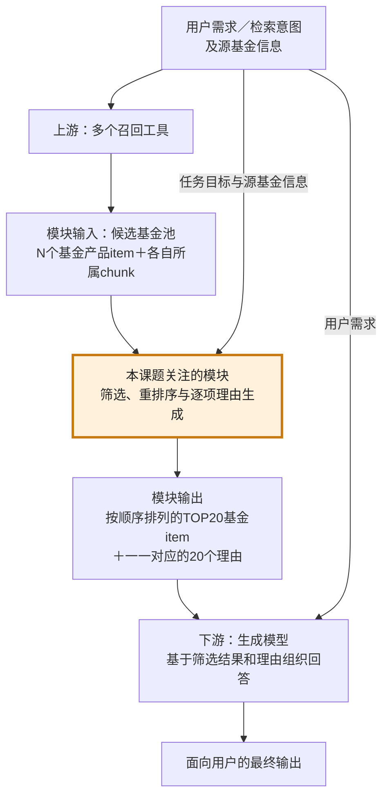
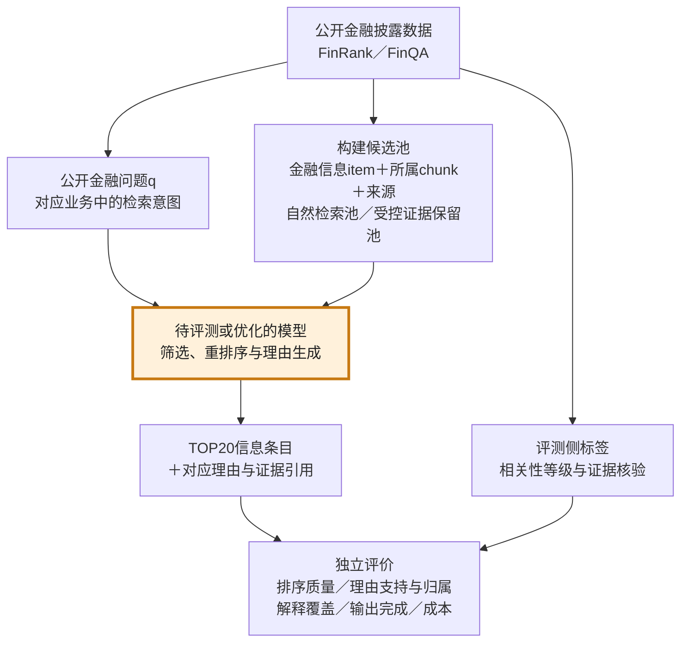

# 毕业论文选题与研究方案汇报

**拟定题目：面向金融信息条目长候选池重排序的理由证据一致性分析与优化研究**
汇报日期：2026年10月12日

拟从金融信息检索中的一个实际问题出发开展毕业论文研究：当大语言模型需要从大量候选信息中选出相关条目，并逐项说明选择理由时，排序结果可能仍较合理，但理由中会出现主体、关系或证据归属错误。本课题计划使用公开财报数据构建可复现实验，围绕“错误由哪些因素引起、如何评价这些错误、怎样通过后训练改善”三个问题展开。以下汇报选题来源、文献基础、数据方案和实验设计。

目前已完成文献整理、部分公开数据下载核验及候选池构造样例；模型评测、完整标签补充和后训练尚待开展。因此，下文中的实验规模和方法效果均为研究计划。

## 一、题目来历与研究背景

### 1.1 实际应用中需要模型完成什么任务

金融搜索系统通常先通过关键词检索、向量检索等渠道获取一批候选，再对候选重新排序，把最符合用户需求的结果排在前面。这一步称为**重排序**。采用大语言模型后，系统还可以为每个结果生成简短理由，说明它为什么符合需求、依据来自哪段资料。

本课题的业务来源是基金搜索场景。系统给定一个源基金及检索意图，上游返回多个候选基金和相关资料，模型需要从中选出前20项，并说明它们与源基金的关系。每个候选由两部分组成：**条目（item）**，即产品名称和身份信息；**证据片段（chunk）**，即检索得到的产品说明等文本。模型既要比较条目，也要正确使用每个条目所属的资料。

**图1：业务流程及本课题关注模块的位置**

该模块位于**多工具召回之后、最终回答生成之前**。上游负责提供候选基金及资料；本模块结合检索意图和源基金信息，筛选并排序TOP20条目，为每项生成一个理由；下游生成模型再依据这些结果形成最终回答。20个理由应与20个条目按编号一一对应，理由中的产品属性和关系判断应能回指相应条目的输入证据。

| 环节 | 输入 | 输出与职责 |
|---|---|---|
| 上游多工具召回 | 用户需求、检索意图及源基金信息 | 返回候选基金产品item及其所属chunk，形成待比较的候选池 |
| **本课题关注的重排模块** | 任务目标、源基金信息、N个候选item＋chunk | 筛选并排序TOP20 item，生成对应的20个理由 |
| 下游生成模型 | 用户需求、TOP20 item及其对应理由 | 综合组织面向用户的最终回答 |

因此，理由错误可能沿流程传递：即使某个条目被正确选入TOP20，下游生成模型仍可能沿用该条目的错误理由，把不受证据支持的关系写入最终回答。本研究首先检查重排模块输出的理由；最终回答中的错误传播可作为扩展观察，当前主要实验仍以重排模块为评价对象。

业务候选池曾设置为80、150和250项，每项约含10字名称和500字资料。250项仅这两部分就约有127,500个字符，还需要加入任务说明、源产品资料和输出。候选数量和输入长度是两个相关但不同的变量。

### 1.2 观察到的问题及其研究意义

业务测试中出现过一种典型错误：模型把“某候选本身是ETF联接基金”解释成“该候选与源基金具有ETF与联接基金的对应关系”。前者是单个产品的属性，后者是两个产品之间的特定关系，二者需要不同的证据。

这说明模型即使选择了看似合理的候选，也可能给出证据无法支持的关系解释。对于需要查阅理由的用户，排序正确并不能抵消理由错误；理由会影响用户如何理解和使用结果。因此，有必要同时评价**排序质量**和**理由是否受到当前条目证据支持**。

现有业务观察只有少量查询和单次调用，候选扩容时还改变了候选构成，因而只能作为研究动机。候选增加是否确实导致错误、主要影响来自长度还是相似干扰，都需要通过对照实验检验。

### 1.3 为什么采用公开金融披露数据

企业内部的基金候选、检索问题和证据文本难以作为可公开复现的数据。本研究计划保留“查询＋候选条目＋所属证据＋排序与理由”的任务结构，使用公开公司财报中的披露事项和财务指标替代内部产品资料。

例如，查询为“某公司在指定财年有哪些业务分部”，候选包括该公司和其他公司的分部披露。模型需要优先选择目标公司、目标期间的证据，并解释其适用性。相同术语出现在不同公司、期间和披露章节中，为研究证据归属错误提供了自然条件。

由此，正式研究对象界定为**金融信息条目重排序**。研究结论适用于公开金融披露证据场景，向基金搜索场景的迁移作为后续应用讨论。

## 二、问题定义与三个研究问题

### 2.1 输入、输出与研究边界

一次任务的输入包含公开金融问题q和N个候选。每个候选包含中性编号、条目标题、所属证据文本，以及公司、报告和页面等来源信息。条目可以是“某公司—业务分部披露”或“某公司—经营现金流指标”；同一家公司可以对应多个条目，因此250项候选并不意味着250家公司。

输出为按证据价值排列的前K项，主设置为K=20。每项附相关程度说明、简短理由和可定位的证据引用。公开问题可能只有少数直接支持项，因此前20项中允许存在弱相关或不支持项，模型应如实说明其局限。

**图2：公开实验与业务模块的对应关系**

公开实验保留图1中重排模块的输入输出结构：基金产品替换为金融披露条目，内部检索意图替换为公开金融问题。评测标签只进入独立评价环节；受控池可以利用金标保留必要证据，但正负标签不进入模型输入。这样可以直接观察模块是否选对证据、是否为每个条目给出正确理由，再分析候选扩容和后训练的影响。

以下例子用于说明任务与错误类型，其中内容为已有FinRank样例的中文释义：

| 查询或候选 | 内容 | 应有判断 |
|---|---|---|
| 查询 | Johnson & Johnson（JNJ）在FY2024有哪些可报告业务分部？ | 同时核对公司、财务期间和披露事项 |
| 候选A：JNJ业务分部披露 | 原文列出Innovative Medicine与MedTech两个业务分部 | 优先排序，并以本项原文解释 |
| 候选B：Eli Lilly（LLY）分部信息 | 原文描述LLY按一个可报告分部经营 | 主题相近，但不能作为JNJ分部数量的依据 |
| 典型错误 | 选择候选A，却在理由中使用候选B的“一个分部” | 排序与理由归属发生分离 |

本题的“理由证据一致性”指：理由中的声明受到该条目文本或明确标识的来源元数据支持，且正确说明其与查询的关系。评价还需保留公司、期间、指标、单位等限定条件。显式理由是否正确，与模型内部推理过程是否忠实，是不同问题；本研究主要评价前者。

### 2.2 三个研究问题

| 研究问题 | 具体内容 | 预期形成的成果 |
|---|---|---|
| **RQ1：哪些因素影响理由证据一致性？** | 分别考察输入长度、候选数、独立主体数、相似干扰、证据位置及排序与理由联合输出 | 影响因素的受控比较和适用边界 |
| **RQ2：错误如何表现，怎样可靠评价？** | 区分跨条目错配、期间/指标混淆、无依据补全，以及排序与输出协议问题 | 错误分类、标注规范和候选扩容评测协议 |
| **RQ3：怎样改善，同时保持排序质量？** | 检验证据归属监督、困难负例训练和针对绑定错误的偏好优化 | 后训练方法、消融结果、泛化与成本分析 |

研究路径为：先确认现象并建立评价方法，再通过受控实验分析影响因素，最后针对仍未被简单方法解决的错误开展后训练。

## 三、围绕三个问题的文献综述

文献按上述三个问题组织。正文列出与研究设计直接相关的方向、代表工作和启发；完整分支及扩展阅读另附XMind导图。问答、幻觉检测和文本排序的已有结论作为设计依据，迁移到本题后的效果仍需验证。2026年相关工作中属于预印本的条目在下表注明。

### 3.1 RQ1：为什么可能出错——长度、绑定与干扰

| 综述方向 | 代表文献 | 已有研究与本题的联系 |
|---|---|---|
| 长上下文中的证据位置 | [Lost in the Middle，TACL 2024](https://aclanthology.org/2024.tacl-1.9/) | 相关信息的位置会影响长输入中的信息利用；本题设置前、中、后位置对照 |
| 输入长度本身的影响 | [Same Task, More Tokens，ACL 2024](https://aclanthology.org/2024.acl-long.818/) | 在任务条件受控的情况下研究长度影响；支持固定关键证据、改变外围上下文的设计 |
| 实体与属性绑定 | [How do Language Models Bind Entities in Context?，ICLR 2024](https://arxiv.org/abs/2310.17191) | 提供实体与属性绑定的机制研究；启发考察公司—指标—期间的归属，但不能据此直接判定业务错误的内部机制 |
| 字面相似与关联检索 | [NoLiMa，ICML 2025](https://arxiv.org/abs/2502.05167) | 考察超越字面匹配的长上下文检索；支持区分关键词相似干扰与真正相关证据 |
| 证据充分性 | [Sufficient Context，ICLR 2025](https://arxiv.org/abs/2411.06037) | 区分输入是否足以作答与模型是否正确使用输入；本题先核验必要证据是否仍在输入中 |
| 候选排列影响 | [Permutation Self-Consistency，NAACL 2024](https://aclanthology.org/2024.naacl-long.129/) | 相同候选的排列会影响判断；支持多排列诊断和聚合基线 |
| 金融来源约束与困难负例 | [FinRank，2026预印本](https://arxiv.org/abs/2608.07400) | 金融事实在不同公司、期间和章节中重复出现，来源敏感的困难负例影响证据识别；直接支持本题的干扰类别 |

这些工作提示：候选扩容同时改变了长度、待区分对象数量和干扰分布，不能仅以“长上下文”概括全部原因。本题拟分别控制这些因素，并检查其交互作用。金融术语是否带来额外困难，则通过匿名化和同构对照辅助检验。

### 3.2 RQ2：会出现什么错误——事实支持、出处与任务完成

| 综述方向 | 代表文献 | 对本题评价体系的启发 |
|---|---|---|
| 细粒度无依据生成 | [RAGTruth，2024](https://arxiv.org/abs/2401.00396) | 细粒度幻觉标注提示应检查具体声明，而非仅给整个回答一个分数 |
| 声明级支持性核验 | [RefChecker，2024作者版本](https://arxiv.org/abs/2405.14486) | 将生成文本拆为声明并判断支持、矛盾或中立；本题保留主体、期间和单位限定 |
| 检索与生成错误拆分 | [RAGChecker，2024作者版本](https://arxiv.org/abs/2408.08067) | 分析检索覆盖、噪声敏感和无依据生成；本题进一步区分“全池中有该事实”和“该事实属于当前条目” |
| 金融声明验证 | [FinDVer，EMNLP 2024](https://aclanthology.org/2024.emnlp-main.818/) | 为金融文本、数值等声明核验提供参考；其原任务不提供本题完整排序标签 |
| 细粒度引用 | [LongCite，Findings ACL 2025](https://arxiv.org/abs/2409.02897) | 提供长文引用生成与训练思路；引用能定位仍需进一步检查语义支持和条目归属 |
| 生成内容的上下文归因 | [ContextCite，NeurIPS 2024](https://arxiv.org/abs/2409.00729) | 区分哪些来源影响了生成与哪些来源真正支持声明；本题主要评价支持性，证据干预作为辅助诊断 |
| 任务完成与可靠性 | [The FACTS Grounding Leaderboard，2025作者版本](https://arxiv.org/abs/2501.03200) | 同时关注请求完成和依据可靠性；本题加入有效解释覆盖和协议成功率 |

据此，拟建立以下错误分类：

| 错误类型 | 判定要点 |
|---|---|
| 跨条目证据归属错误 | 理由中的事实来自其他候选，却被归给当前条目 |
| 公司、期间或指标错配 | 忽略查询或证据中的关键限定条件 |
| 数值、单位或口径错误 | 数字出现过，但其对象、单位、范围或计算口径不适用 |
| 支持关系误判 | 内容主题相似，却被解释为直接支持当前问题 |
| 无依据补全 | 输入未提供某个事实或原因，理由仍作确定性断言 |
| 排序错误 | 相关证据未进入前列，或其相对次序不合理 |
| 输出协议错误 | 缺项、重复编号、池外编号、不可解析或截断 |

前五类构成主要语义错误，后两类单独报告。评价同时检查“选得是否合适”和“说得是否有依据”，避免只看排序指标或只看已经输出的理由。

### 3.3 RQ3：如何改善——任务拆分与后训练

| 方法方向 | 代表文献 | 本题拟借鉴或比较的内容 |
|---|---|---|
| 分组与滑窗重排序 | [RankGPT，EMNLP 2023](https://aclanthology.org/2023.emnlp-main.923/)；[ListT5，2024作者版本](https://arxiv.org/abs/2402.15838) | 控制单次候选规模；作为小模型处理大候选池的系统基线 |
| 金融结构化证据 | [FinCARDS，2026预印本](https://arxiv.org/abs/2601.06992) | 结构化金融证据与约束处理；比较元数据规则及证据卡片能够解决多少错误 |
| 抗干扰监督微调 | [RAFT，2024作者版本](https://arxiv.org/abs/2403.10131)；[Making Retrieval-Augmented Language Models Robust to Irrelevant Context，ICLR 2024](https://arxiv.org/abs/2310.01558) | 训练模型在相关和干扰资料并存时使用证据；普通困难负例训练应作为必要对照 |
| 证据先行与偏好优化 | [FRONT，Findings ACL 2024](https://aclanthology.org/2024.findings-acl.838/) | 先定位证据再生成，并以一致性偏好训练；是本题方法的直接近邻 |
| 证据干预与引用优化 | [SelfCite，ICML 2025](https://arxiv.org/abs/2502.09604) | 利用证据保留/删除构造信号；借鉴其对扰动和长度捷径的分析 |
| 长上下文偏好训练 | [LongReward，ACL 2025](https://arxiv.org/abs/2410.21252) | 多维质量反馈与偏好优化；本题分别评价排序、依据和覆盖 |
| 细粒度引用奖励 | [Training Language Models to Generate Text with Citations via Fine-grained Rewards，2024作者版本](https://arxiv.org/abs/2402.04315) | 正确性、引用精确度与召回奖励已有研究；作为通用依据优化的近邻 |
| 排序强化学习 | [RankR1，2025作者版本](https://arxiv.org/abs/2503.06034)；[REARANK，EMNLP 2025](https://aclanthology.org/2025.emnlp-main.125/) | 排序奖励与推理训练已有基础；排序收益能否同时改善理由归属需要另测 |

本题拟采用的中心方法是**针对金融证据绑定错误的偏好后训练**：先通过监督微调学习条目、证据和理由的对应关系，再构造同一输入、相近排序和相近长度的正确/错误理由对，用直接偏好优化（DPO）减少归属错误。监督微调（SFT）和DPO分别作为基础阶段与改进阶段；强化学习仅作为资源允许时的扩展。

已有工作已经覆盖证据先行、困难负例、引用训练和偏好优化。因此，拟验证的研究增量是：在长候选池干扰中识别具体金融绑定错误，建立可复现评测，并证明针对该错误的训练在强基线之上仍有收益，且能保持排序质量和有效解释覆盖。

## 四、实验数据的来历与构建方案

### 4.1 数据来源与用途

| 数据 | 原始内容及来源 | 本题用途 | 当前准备程度 |
|---|---|---|---|
| **FinRank：主数据候选** | 公开金融问题、SEC公司披露中的支持片段及人工构造困难负例；[论文](https://arxiv.org/abs/2608.07400)、[作者仓库](https://github.com/datanxt/FinRank) | 构建披露事项条目、长候选池和来源敏感干扰 | 已下载固定版本；本地解析1,185题、22个目标公司、5,230段去重原文；需继续核验出处和标签 |
| **FinQA：独立诊断数据** | 财报正文、表格、问题、支持证据索引与计算程序；[论文](https://aclanthology.org/2021.emnlp-main.300/)、[作者仓库](https://github.com/czyssrs/FinQA) | 构建指标/实体条目，检查数值、期间和表格证据绑定 | 已下载开发集883条并生成真实样例；训练阶段另取得训练数据并隔离报告 |
| **FinDER：可选扩展** | 金融问题、参考证据与报告资源；[作者发布页](https://huggingface.co/datasets/Linq-AI-Research/FinDER) | 扩展自然检索语料，或作为主数据质量不达标时的备选 | 已核对发布字段，尚未完成报告下载与证据对齐 |

FinRank与本题最接近，但属于较新的预印本资源，正式采用前需进行质量审核。FinQA原任务是数值问答，其答案和程序可辅助证据核验，不能直接作为扩容后的全部候选排序标签。研究优先完成一套主数据和一套独立诊断，避免同时扩展过多数据集。

### 4.2 从公开数据到模型输入

数据构建按以下步骤进行：

1. **固定版本与来源。** 保存数据版本、报告出处和文件哈希，建立问题、报告、片段的对应关系。
2. **构建条目。** 从披露标题、表格行或正文主题生成有语义的条目标题；全部候选采用相同、独立于查询的规则，并核对标题是否准确。
3. **构建证据片段。** 保留主体、期间、表头、单位和必要上下文，建立片段到原报告的定位。正文所述财务期间与报告申报年份分别记录。
4. **控制输入预算。** 按实际tokenizer设置片段预算，候选档位拟取20、50、100、150、250项。切块后重新检查关键证据是否完整；超出上下文窗口的配置记录为不可运行。
5. **形成候选池并补充标签。** 按自然检索和受控抽样两种方式构造，新增候选逐项判断相关性。
6. **隔离评测信息。** 模型输入只含问题、条目、证据和来源。标准答案、支持索引、正负角色及标签另存；原数据中可能暴露正负身份的编号替换为中性编号。

两种候选池承担不同实验目的：

| 候选池 | 构建方式 | 用途与评价边界 |
|---|---|---|
| 自然检索池 | 使用BM25或冻结检索器返回前N项，金标不参与补入候选 | 评价实际检索后重排；同时报告池内支持证据召回上限 |
| 受控证据保留池 | 固定必要证据和基础困难负例，逐步增加指定干扰 | 隔离扩容、长度和干扰因素；明确属于金标参与构造的诊断实验 |

现有20—250项文件是构造样例。其中一个250项样例只有1项原正例和6项原负例，其余243项尚未判断；完整原文约101万英文字符，仍需预算化处理。完成补判和证据保留检查后，才能用于正式评测。

### 4.3 标签与人工核验

相关性标签拟设为三级：2表示直接支持问题或提供必要推理证据，1表示提供相关背景但不足以直接支持，0表示不支持。具体边界在试标阶段确定；原数据的二元标签需复核后映射。尚未判断的候选保留为未知，不能默认记为0。

理由评价将每项理由拆为带限定条件的原子声明，标记为支持、矛盾或证据不足，并记录错误类型。标注者同时核查当前条目和整个候选池：若声明被其他条目支持、却不属于当前条目，记为归属错误。正确说明“不适用于该问题”的理由也属于有效解释。

拟先试标10题形成规范，再对至少50题进行主数据质量抽查。正式评测子集由两名标注者独立标注并协商分歧，报告一致性；自动核验器在人工子集上校准后用于辅助，不能以待优化模型自评代替依据核验。

### 4.4 数据划分与计划规模

划分在生成扩容、排列和反事实变体之前完成。同一报告、近重复片段及基础问题的变体放在同一集合；未见公司测试还要检查该公司是否作为训练负例出现。

先用20—30个查询开展探索性实验，确定错误频率、窗口和成本，再建设约30—50个充分标注的长池测试查询。50题、每题250项对应12,500个问题—候选配对，具体规模根据试标耗时和先导效应确定，并在论文中报告统计精度。

后训练先制作约500条核验样本跑通流程，再视成本扩至约3,000—5,000条SFT样本和约1,000—2,000对偏好样本。训练样本来自训练划分；FinQA当前下载的开发集保留用于诊断，不用作训练材料。

## 五、评价指标与实验共同设置

### 5.1 指标定义

| 评价维度 | 指标 | 计算与解释 |
|---|---|---|
| 排序质量 | NDCG@5/10/20 | 依据独立相关性等级评价前列质量；增益取2^等级−1，评测前固定 |
| 证据检出 | Recall@K、MRR | Recall衡量必要支持项进入前K的比例；MRR衡量首个直接支持项的位置 |
| 上游召回 | PoolRecall@N | 候选池已包含的支持项占已标注支持集合的比例，解释重排的可达上限 |
| 理由支持 | 原子声明支持率 | 支持声明数÷全部可核验声明数；另报矛盾与证据不足比例，空理由单列 |
| 归属错误 | 条目级错绑率 | 含跨条目或主体/期间/指标归属错误的有效输出条目数÷有效输出条目数；缺失项由覆盖指标反映 |
| 有效解释覆盖 | 正确且实质的解释覆盖率 | 具有完整正确说明的条目数÷要求输出的K；正确局限说明计入，空泛或缺失理由不计入 |
| 输出完成 | 协议成功率 | 合法、唯一、完整K项且可解析的输出次数÷全部调用次数；截断和失败进入分母 |
| 扰动稳定 | 集合重合、共同项次序变化、支持判断翻转率 | 在同池多排列或无关扰动下计算；加入更相关项后的合理排序变化不作为错误 |
| 事实敏感 | 反事实判断准确率 | 关键主体、期间或指标改变后，判断是否按新证据正确改变 |
| 资源成本 | token、调用数、延迟、训练显存与耗时 | 分组、聚合和验证等全部子调用计入总成本 |

主评价关注**条目级错绑率和有效解释覆盖**，同时以NDCG@20作为排序保持指标。原子声明支持率用于解释错误构成，避免短理由或少输出造成表面收益。排序允许损失范围依据验证集和任务需求预先确定，测试阶段冻结。

### 5.2 共同设置与统计方式

拟选择一个可用API模型和一个可本地训练的小模型开展先导实验，保存精确版本、调用日期、提示、采样参数、候选顺序和原始输出。大候选池比较时同时报告N与实际token长度。

主实验以查询为配对比较单位；同题不同排列和重复调用作为组内重复。若查询共享报告，则按报告聚类计算置信区间。采用配对bootstrap报告差值及95%置信区间；先导实验用于确定正式规模，测试集用于一次冻结评测。

## 六、各项实验的目标、指标、设计与依据

### E0：数据与任务协议先导实验

**目标：** 确认模型能够理解任务，并排除证据截断、标签泄漏、标题错误或输出要求冲突导致的假象。

**设计：** 抽取20—30题，人工检查支持证据和来源；以清晰提示要求完整Top20，并允许弱相关项说明局限。比较完整条目＋证据、仅条目和仅证据三种输入，检查证据是否被实际利用。逐次记录token和原始输出。

**指标：** 协议成功率、证据保留率、初步NDCG@20、错绑率、解释覆盖及单题成本。只有证据完整的样本进入后续长度归因。

**依据：** Sufficient Context对证据充分性的区分、FinRank的来源约束、FinQA的支持证据索引。该实验为后续研究建立有效输入和评价前提。

### E1：候选池扩容与错误表现

**目标：** 判断候选增加时，排序与理由是否发生不同程度的退化，建立RQ2的规模曲线。

**设计：** 对同一查询构造20、50、100、150、250项嵌套池。在受控池中固定必要证据，按固定干扰比例扩容；每档使用多个预先保存的排列。自然检索池另行运行，用于检查结论在实际检索中的表现。此实验允许长度随扩容增长，描述整体扩容效应。

**指标：** NDCG@20、Recall@20、错绑率、声明支持率、有效解释覆盖、协议成功率及成本。额外统计“必要证据进入Top20但理由归属错误”的发生比例。

**依据：** RankGPT的候选重排设置、FinRank的金融困难负例，以及RAGChecker对检索和生成错误的拆分。长度与对象数量的独立作用由E2继续检验。

### E2：输入长度、候选数量与独立主体数量的分离实验

**目标：** 回答RQ1，检查候选扩容的影响主要来自文本加长，还是更多对象需要被区分和绑定。

**设计：** 分为三个配对对照：①固定候选数、主体数和决定性证据，增加同源的非决定性上下文；②尽量匹配总token，改变候选数，并保证每项最小必要证据完整；③固定候选数和长度范围，改变独立公司数量及同公司条目比例。对②③人工检查证据信息量；无法严格匹配时报告剩余混杂。

**指标：** 错绑率、支持率、NDCG@20、解释覆盖，以及随token、候选数和主体数变化的配对差值。

**依据：** Same Task, More Tokens提供长度控制思路，实体绑定研究提供对象数量与属性归属的假设。该实验主要支持行为层面的影响因素分析。

### E3：相似干扰与证据位置实验

**目标：** 找出最容易触发金融归属错误的干扰类别，并检查其与位置的交互。

**设计：** 在候选数、长度范围和必要证据固定时，分别加入随机低相关干扰、同指标不同公司、同公司不同期间、同主体异指标/口径的干扰。将关键证据放在前、中、后位置，并对相同候选随机排列。先比较单因素，再对影响较大的条件做有限交互实验。

**指标：** 分类别错绑率、支持关系误判率、NDCG@20、判断翻转率及位置间差值。

**依据：** Lost in the Middle支持位置对照；NoLiMa支持字面干扰与关联判断的区分；FinRank直接提供跨公司、跨期间和相近披露的困难负例设计。

### E4：排序与理由联合输出实验

**目标：** 判断同时排序和解释是否增加证据错误，并确定任务拆分基线能够解决多少问题。

**设计：** 比较只排序、联合排序＋理由、先排序再逐项局部解释。理由端先固定同一份Top20及顺序，在全池和局部证据条件下生成，隔离解释差异；随后进行端到端比较，检验整体收益。分两阶段方法的全部调用与输出长度计入成本。

**指标：** 固定排名下的错绑率、支持率和解释覆盖；端到端NDCG@20、协议成功率和总成本。只排序组仅用于排序指标比较。

**依据：** FRONT的证据先行生成、LongCite的引用生成训练，以及RankGPT的排名输出。若局部解释已经达到同等可靠性，应据此明确后训练的必要范围。

### E5：证据缺失、反事实与领域对照实验

**目标：** 检查模型能否在无依据时正确说明局限、在事实变化时更新判断，并辅助分析金融表达的作用。

**设计：** 对同一基础样本构造三类变体：①删除全部必要支持证据，同时保留主题相近干扰；②经人工核验后替换决定性主体、期间或指标，并更新评测标签；③保持关系结构和长度尽量一致，将公司名和指标映射为匿名对象，辅以少量匹配的一般领域任务。原样本与变体放在同一数据划分，分别报告。

**指标：** 缺证据条件下的无依据断言率、正确局限说明率、反事实判断准确率、错绑率与领域对照差值。

**依据：** Sufficient Context区分证据不足；SelfCite提供证据干预思路；实体绑定研究支持同构诊断。匿名化可能改变语义难度，因此其结果作为辅助解释。

### E6：后训练效果与方法消融实验

**目标：** 回答RQ3，判断针对绑定错误的训练是否比普通监督和通用引用优化更有效。

**设计：** 使用同一底座、固定候选处理流程和尽量匹配的训练数据预算，依次比较：冻结模型、普通证据SFT、普通困难负例SFT、绑定监督SFT、通用引用DPO、绑定偏好DPO。同时加入元数据规则过滤、证据卡片和排序后局部解释等强基线。

绑定训练要求输出条目编号、支持状态、短理由和来源。偏好对尽量保持同一排名、相近长度，只改变理由中的归属正确性；排序偏好另建。负例同时包括模型自然错误和人工核验的受控错配。

消融优先检查：去掉主体/期间归属监督、去掉困难负例、仅使用合成错误、去掉长度匹配、去掉排序保护。由验证集选择必要配置，不进行全部组合。

**指标：** 错绑率和有效解释覆盖为主，联合报告NDCG@20、支持率、协议成功率及训练/推理成本。只有理由改善同时保持排序和覆盖，才支持方法有效的主张。

**依据：** RAFT与抗无关上下文训练构成普通干扰SFT基线；FRONT、SelfCite和LongReward构成证据与偏好优化近邻；FinRank提供金融来源约束。需要证明的增量是针对绑定错误的监督，而非SFT或DPO算法本身。

### E7：跨规模、跨主体泛化与资源评估

**目标：** 检验方法是否能够迁移到未见公司、期间及更大候选池，并评估实际使用成本。

**设计：** 在训练未使用的公司/报告和更高困难干扰比例上测试；将小候选窗训练的方法通过固定分组流程应用于100—250项系统级候选池，并与相同流程下的未训练模型比较。另用FinQA诊断检查指标和表格证据绑定。分别给出相同流程、相同成本预算两种比较。

**指标：** 泛化条件下的NDCG@20、错绑率、解释覆盖、性能差值，以及总token、调用数、延迟、显存和训练耗时。

**依据：** FinRank的来源及跨公司/期间设置、FinQA的表格与正文证据、RankGPT/ListT5的候选管理方法。单次短窗处理和系统级大池处理分别表述，避免混淆能力范围。

## 七、实施路线、预期贡献与可行性

### 7.1 实施安排

| 阶段 | 主要工作 | 阶段产出 |
|---|---|---|
| 第一阶段：数据与协议 | 完成来源抽查、证据预算、标签规范和E0 | 可运行输入、人工标注子集与可靠评测协议 |
| 第二阶段：现象与影响因素 | 开展E1—E5，优先验证主效应，再扩展必要交互 | 错误分类、规模曲线和受控比较 |
| 第三阶段：方法优化 | 开展E6，以SFT和DPO为主，完成强基线及必要消融 | 后训练模型与方法增益证据 |
| 第四阶段：泛化与论文 | 完成E7，整理成本、局限和复现材料 | 完整实验结果与论文稿 |

本地训练优先选择约1.5B—4B级开源模型，以LoRA/QLoRA和2K—4K token短窗起步，在24GB GPU上先实测显存。大池通过固定分组流程处理；单次长输入诊断可使用窗口足够的API模型。GRPO等在线强化学习在基础方法和奖励核验稳定后再决定是否增加。

### 7.2 预期贡献及验证条件

预期形成三项相互衔接的成果：

1. **公开可复现的任务与评价协议。** 基于金融披露数据构建长候选池，分别评价排序、条目级依据和有效解释覆盖。
2. **理由错误的受控分析。** 说明长度、对象数量、相似干扰、位置和联合任务在什么条件下影响证据归属。
3. **针对实测错误的后训练方法。** 检验绑定监督和偏好训练能否在强基线之上改善理由可靠性，并保持排序质量与泛化能力。

目前最大的工作量在于扩容后的相关性补判、理由标注和证据对齐。若主数据质量不足，优先采用FinQA可核验诊断或完成FinDER对齐；若简单规则、局部解释或普通SFT已经解决主要错误，研究结论将围绕这些有效方法及其适用条件收敛。若长度控制后不再出现显著退化，则据实讨论相似干扰或对象绑定的影响。

我希望围绕这一范围推进开题：以公开金融披露为实验场景，以理由证据归属为核心问题，以排序质量和解释覆盖为约束，先完成可复现的现象与评价，再开展有针对性的后训练。恳请老师指导研究范围、主数据选择，以及“受控分析＋评测协议＋后训练验证”的贡献组合是否适合作为毕业论文主线。

## 附：文献导图

配套附件为《选题2_三问文献综述与研究路线.xmind》，按“影响因素—错误表现与评价—改进方法”三个主分支整理。正文已列出支撑本方案的核心方向和代表文献，导图用于展开扩展阅读，不影响本文独立阅读。
